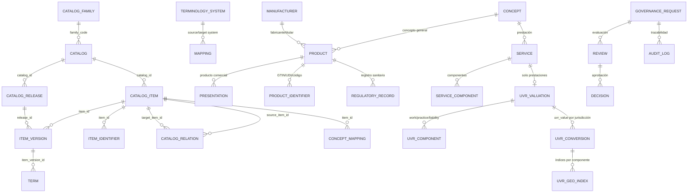

# Propuesta de arquitectura extensible de catálogos y nomencladores de Origen Salud

> **Estado: documento de auditoría, análisis y diseño. Propuesta para aprobación.**
>
> No se ejecutaron migraciones SQL, no se modificó la base de datos, no se
> modificaron importadores, endpoints ni contratos de API, no se renombraron
> códigos y no se realizaron commits, push ni deploy. Ninguna extensión
> propuesta en este documento se considera aprobada. Toda implementación
> requiere aprobación explícita previa.
>
> Esta propuesta respeta el registro de decisiones multilingüe
> (`decisiones-arquitectura-multilingue.md`, D-01 a D-41), que sigue siendo la
> referencia de coherencia en materia de idioma, procedencia y publicación.
>
> Fecha: 2026-11-18

---

## Índice

1. [Diagnóstico de la arquitectura actual](#1-diagnóstico-de-la-arquitectura-actual)
2. [Arquitectura objetivo](#2-arquitectura-objetivo)
3. [Modelo conceptual](#3-modelo-conceptual)
4. [Diagrama entidad-relación](#4-diagrama-entidad-relación)
5. [Catálogos existentes y propuestos](#5-catálogos-existentes-y-propuestos)
6. [Clasificación de los dominios](#6-clasificación-de-los-dominios)
7. [Relaciones entre catálogos](#7-relaciones-entre-catálogos)
8. [Modelo de productos, presentaciones e identificadores](#8-modelo-de-productos-presentaciones-e-identificadores)
9. [Modelo de terminologías externas y mapeos](#9-modelo-de-terminologías-externas-y-mapeos)
10. [Modelo de valoración UVR](#10-modelo-de-valoración-uvr)
11. [Estrategia de versionado](#11-estrategia-de-versionado)
12. [Estrategia de internacionalización](#12-estrategia-de-internacionalización)
13. [Diseño de API](#13-diseño-de-api)
14. [Compatibilidad con FHIR](#14-compatibilidad-con-fhir)
15. [Riesgos y decisiones pendientes](#15-riesgos-y-decisiones-pendientes)
16. [Plan de migración gradual](#16-plan-de-migración-gradual)
17. [Recomendaciones de implementación por etapas](#17-recomendaciones-de-implementación-por-etapas)
- [Apéndice A — Propuesta de navegación y arquitectura de información](#apéndice-a--propuesta-de-navegación-y-arquitectura-de-información)

---

## 1. Diagnóstico de la arquitectura actual

### 1.1 Base de datos correcta y estado de la carga DENTAR

La base de trabajo correcta es **`origen_codes`**. `origen_salud` es la base
antigua y conserva restos aislados del primer intento de carga AN/CL; no debe
usarse como referencia para esta propuesta.

Estado verificado en `origen_codes` al cierre de la carga:

| Catálogo | Ítems | Estado |
|---|---:|---|
| `dentar-pr` | 844 | activo |
| `dentar-dx` | 223 | activo |
| `dentar-an` | 624 | activo |
| `dentar-cl` | 218 | activo |

Relaciones CDT (`os_catalog_relation`): **333 filas, 303 pares únicos, 15
tipos**; identificadores `CDT-2025`: **805**. La clave única incluye
`context_text` porque 18 grupos de filas comparten origen, destino, tipo,
campo y código CDT pero tienen contextos distintos, todos reales de la fuente.

### 1.1.1 Tres generaciones conviviendo en `sql/`

La auditoría del directorio `sql/` confirma **38 archivos `.sql`**, 79
`CREATE TABLE` (70 permanentes + 9 temporales), **66 tablas físicas únicas**,
6 vistas, 17 funciones y 34 triggers directos (más 2 dinámicos). No hay un
único grafo coherente: conviven tres generaciones que se solapan y a veces se
contradicen:

1. **Esquema base y tablas planas** (`01_schema/design.sql`,
   `06_nomencladores/`): SNOMED, CIE-10, nomencladores y vademécum.
2. **Motor canónico `os_*`** (`02_catalogs/origen_catalog_engine.sql`): 17
   tablas de catálogos, terminologías, precios y farmacia, sin funciones,
   triggers ni vistas propias.
3. **Capa aditiva multilingüe** (`07_multilingue/`, scripts `01`–`18`): 6
   tablas nuevas, columnas, 29 triggers y funciones de hash/ auditoría,
   ejecutada en `origen_codes` con datos de prueba y con el corte de Fase 13
   preparado pero **no activo**.

Esta superposición explica buena parte de las inconsistencias del §1.3.

### 1.2 Lo que ya resuelve la arquitectura actual

El esquema `os_*` no es un prototipo incipiente: ya cubre una parte importante
de los requisitos. El motor canónico define 17 tablas (líneas 12–237 de
`origen_catalog_engine.sql`) y la capa multilingüe añade trazabilidad avanzada.

- **Núcleo de catálogos:** `os_catalog`, `os_catalog_release`,
  `os_catalog_item`, `os_catalog_item_version`, `os_catalog_term`,
  `os_catalog_identifier`, `os_catalog_category`, `os_catalog_language`.
- **Versionado y vigencia:** release por catálogo con `valid_from`/`valid_to`,
  estados de versión, `permanent_code` estable, retiro por estado y no por
  borrado.
- **Multilenguaje:** `os_catalog_item_version.language_code`,
  `os_catalog_term.language_code`, `os_language`, `os_language_alias`,
  `os_catalog_language`, `os_field_review`, `os_localized_text`,
  `os_translation_review`, además de la capa de resolución en PHP
  (`LanguageResolver`, `EditorialEvaluator`, `EditorialResult`,
  `FieldReviewRepository`, `MappingReviewReader`). Las decisiones D-01 a D-41
  ya definieron el contrato, aunque **nada de eso fue ejecutado**.
- **Mapeos:** `os_concept_mapping` ya registra sistemas, códigos, tipos y
  estado de revisión, con dual-read editorial. Atención: su
  `review_status` tiene `DEFAULT 'approved'` (`engine:130`), es decir, todo
  mapeo nuevo nace aprobado; es un riesgo de gobernanza a corregir.
- **Farmacia:** ya existe el encadenamiento
  `os_substance → os_medicinal_product → os_product_package →
  os_product_identifier` (`engine:200–237`), que es el antecedente directo
  del modelo de concepto/producto/presentación del §8.
- **Precios:** `os_pricing_unit`, `os_fee_schedule`, `os_fee_item` y
  `os_pricing_values` (`engine:142–195`) ya modelan unidades, listas e ítems
  de precio. `os_pricing_values` tiene los tres componentes `*_rvu`,
  `conversion_factor`, `estimated_payment` y vigencia, pero **no tiene
  ninguna FK ni ningún `INSERT`** en todo `sql/`: está vacía y desconectada.
- **Relaciones tipificadas:** la tabla `os_catalog_relation` creada para CDT
  conserva 15 tipos reales, sistema/versión de origen, campo y contexto,
  estado de revisión y procedencia. Es el mejor antecedente para el modelo
  general de relaciones.
- **Terminologías externas:** SNOMED CT (`snomed_*`, `sct2.*`), CIE-10, LOINC,
  ANMAT, nomencladores argentinos y PMO, con sus estructuras nativas y sus
  propias tablas de descripciones o traducciones.
- **Editorial DENTAR:** `dentar_catalog`, `dentar_concept(_version)`,
  `dentar_diagnosis(_version)`, términos, categorías, mapeos y columnas de
  valoración relativa.
- **API de solo lectura:** ~31 rutas `GET` bajo `/v1` más `/health`, con un
  envelope consistente, autenticación por API key y un motor de catálogos.

### 1.3 Duplicaciones, inconsistencias y limitaciones

1. **Dos motores de catálogo paralelos.** `CatalogEngineService` (API) y
   `CatalogRepository` (portal) duplican whitelists (`DOMAINS`,
   `DOMAIN_CATALOG`, `CATALOG_SOURCES`, `SOURCE_TABLE`, `OS_CATALOG_DOMAIN_TYPES`)
   y grandes bloques SQL. Agregar un dominio exige tocar ambos, más las rutas y
   la documentación. No existe registro único ni autodescubrimiento.
2. **El catálogo se expande por constantes, no por datos.** El descubrimiento
   de dominios depende de listas escritas en código. Un nuevo catálogo no es
   una fila que se publica: es un cambio de código.
3. **Mapeos dispersos.** Conviven `dentar_concept_mapping`,
   `dentar_diagnosis_mapping`, `os_concept_mapping`, `loinc_map` y columnas
   como `codigo_loinc` en `nomencladores_argentina`. No hay un modelo común
   con sistema/versión de destino, método, confianza y vigencia.
4. **Relaciones no navegables.** `os_catalog_relation` existe en la base pero
   `CatalogRepository::itemRelations()` todavía no la consume; las relaciones
   CDT no son visibles en Browse.
5. **Valoración fragmentada.** Los valores relativos y arancelarios están en
   columnas de `dentar_*`, en `os_fee_schedule`, en `nomencladores_argentina`
   (`unit_type`, `unit_value`, `gastos_valor`) y en `pmo_precios`. No hay un
   modelo UVR unificado ni conversión monetaria versionada.
6. **Defecto real en la API.** `ApiException::internalError()` se invoca en
   siete ramas de `TerminologySearchService.php` pero no existe en
   `api/http/ApiException.php`; esas ramas degradan a `500 internal_error` y
   una de ellas filtra `$e->getMessage()`.
7. **FHIR documentado pero no implementado.** No hay ninguna ruta `/fhir` en
   `api/index.php`; además, el guardia de autenticación solo cubre `/v1/`, por
   lo que `/fhir/*` quedaría sin autenticar si se implementara sin ajustarlo.
8. **Contrato documental divergente.** `README-API.md` difiere del código en
   dominios por defecto (`snomed,cie10,odontologia` vs `snomed,cie10,anmat`),
   límite de página (100 vs 50), tipos de CIE-10, campos de `/v1/domains` y
   códigos `DNT-000007` (el modelo real es `DNT-PR-NNNNNN`/`DNT-DX-NNNNNN`).
   No hay OpenAPI. `README.md` afirma keys hasheadas y rate limiting que no
   existen en el código.
9. **API keys en texto plano**, sin rate limit aplicado en PHP.
10. **Cero tests** en `tests/`.
11. **Deuda documental de estado.** `docs/dentar/README.md` todavía afirma que
    AN/CL están planificados y que PR/DX tienen 138/38 códigos, cuando la base
    real tiene 844/223/624/218.
12. **Definiciones duplicadas.** `nomencladores_argentina` y
    `vademecum_comercial` están definidas tres veces cada una
    (`design.sql:310/:344`, `engine:7594/:7614`, `06_nomencladores:19/:50`).
    Gana la primera que se ejecute, con `CREATE TABLE IF NOT EXISTS`; los
    índices difieren entre definiciones, así que el rendimiento depende del
    orden de carga.
13. **`CHECK` cerrados: la laguna de extensibilidad más estructural.**
    `domain_type` (7 valores), `product_role` (2), `entity_type` (12),
    `mapping_type` (5), `relationship_role` (4), `event_type` (8), `action`
    (5), `actor_type` (4), `concept_kind` (4), `sale_type` (4), etc. son
    enumeraciones escritas en el DDL. **Agregar un dominio, un tipo de
    relación o un evento exige modificar una restricción**, no insertar una
    fila. La propuesta debe sustituirlos por tablas de referencia con FK,
    manteniendo los valores actuales como datos semilla.
14. **FKs ausentes en puntos de unión.** `os_pricing_values.catalog_code`,
    `os_catalog.family_code`, `loinc_map.loinc`, `vademecum_comercial.anmat_certificado`,
    `pmo_prestacion.codigo_dentar_pr/dx`, `os_translation_review.target_id`,
    `os_localized_text.entity_id` y `os_field_review.target_id` no referencian
    su entidad (los tres últimos son polimórficos y dependen de triggers).
15. **Gobernanza de mapeos degradada por la sincronización.**
    `sync_dentar_to_os.sql:488–491` **borra todos** los `os_concept_mapping`
    de DENTAR-PR y DENTAR-DX y los reinserta con `review_status='approved'`.
    Como `os_field_review` no tiene FK, las aprobaciones por campo pueden
    quedar huérfanas o contradecirse con el nuevo estado.
16. **Sin control de solapamiento de vigencias.** Ninguna de las tablas con
    `valid_from`/`valid_to` (`os_catalog_release`, `os_fee_schedule`,
    `os_pricing_values`, `dentar_concept_version`, PMO) tiene un `EXCLUDE`
    que impida períodos solapados; solo PMO lo valida en una función.
17. **Releases desvinculados.** `dentar_release` (`core:40`) y
    `os_catalog_release` (`engine:42`) no tienen columna de correspondencia;
    el sync reconstruye el release desde la versión máxima (`sync:83–115`).
18. **Pérdida potencial de texto.** El sync recorta términos DENTAR a 255
    caracteres (`sync:319`, `:441`) mientras `dentar_term` admite 500; además
    borra términos del release PR (`:310–315`) pero inserta los de DX sin
    borrado previo, y `os_catalog_term` no tiene `UNIQUE` en el DDL canónico
    (`uq_oct_identity` existe solo en la capa de pruebas).
19. **Scripts PMO no ejecutables y LOINC destructivo.** Los satélites PMO
    usan `os_catalog_item.observation` y `os_catalog_item_version.catalog_id`,
    columnas inexistentes, y dejan sentencias incompletas
    (`02_pmo_practicas.sql:260–262`, `99_pmo_validaciones.sql:132`). El
    importador LOINC usa `DROP TABLE ... CASCADE` (`importar_loinc.sql:68`,
    `:117`) y sobrescribe 12 campos en español con capas es-MX/es-AR.
20. **Flujo estándar incompleto.** `import_dentar_csv.php` solo acepta
    prefijos `DNT-PR`/`DNT-DX` (`:75–78`, `:458`): AN/CL no pueden recargarse
    con el importador actual y dependen del SQL propuesto. Las validaciones de
    mapeo obligatorio y SCTID son **avisos**, no bloqueos (`:614–646`, `:735–767`).
    La compuerta `ImporterIdentity::assertWritableMode()` solo se invoca en
    este importador (`:440`), no en `import_nomenclador_csv.php` ni en
    `Rf2Importer.php`.
21. **UVR sin datos y con terminología mezclada.** El importador lee columnas
    CSV llamadas `work_rvu`/`practice_expense_rvu`/`malpractice_rvu` y las
    escribe en columnas `*_uvr` (`import_dentar_csv.php:325–345`, `:482–487`,
    `:535–548`), sin validación numérica. Los CSV generados no incluyen esas
    columnas; solo las plantillas las exponen vacías o en `0`. No existe
    ningún `INSERT INTO os_pricing_values` en el repositorio y el sync declara
    explícitamente que no toca aranceles (`sync:33–34`).
22. **Navegación desactualizada.** El portal real es trilingüe con URLs con
    prefijo (`/{locale}/dentar`, `/{locale}/browse`), pero `README.md` sigue
    describiendo un portal bilingüe con `?lang=es|en` y archivos bajo `web/`
    que no existen. La página DENTAR y el `browse-explorer.js` solo ofrecen
    `dentar-pr`/`dentar-dx`, sin rastro de AN/CL ni de las relaciones CDT.
    `/cart` está enlazado desde header, footer e inicio pero no existe como
    ruta, y `sitemap.xml` apunta a un `sitemap.php` inexistente.

### 1.4 Comparación rápida propuesta vs. implementación

| Requisito del prompt | Situación actual | Conclusión |
|---|---|---|
| Catálogos compartidos | `os_catalog*` implementado (17 tablas) | Reutilizar, no rehacer |
| Productos/presentaciones/identificadores | Cadena farmacéutica parcial (`os_substance`→`os_product_package`); sin modelo general | Extender y generalizar |
| Relaciones tipificadas/versionadas | `os_catalog_relation` (CDT) sin versión ni grafos; tipo cerrado por `CHECK` | Extender |
| Mapeos con método/confianza/vigencia | Parcial en `os_concept_mapping`; nacen `approved` por defecto | Extender y corregir |
| UVR con tres componentes y conversión | 4 modelos paralelos; `os_pricing_values` vacío y sin FK | Diseñar módulo nuevo |
| Tipos/dominios extensibles | Enumeraciones en `CHECK` del DDL | Sustituir por tablas de referencia |
| i18n | Maquinaria avanzada; árbitro D-01..D-41 pendiente de aprobación formal; ejecución parcial en `origen_codes` | Aprobar y activar según D-01..D-41 |
| API extensible | Monolito con constantes duplicadas | Refactorizar por datos |
| FHIR R4 | Solo documentación | Implementar después de API |
| Gobernanza | Parcial; mapeos y aprobaciones se degradan en el sync | Unificar |

---

## 2. Arquitectura objetivo

### 2.1 Principios rectores

1. **Identidad propia.** DENTAR conserva nombre completo, marca, prefijos,
   códigos permanentes, releases, comité editorial y gobernanza. `DENTAR` es
   una familia; `DENTAR-PR`, `-DX`, `-AN`, `-CL` son catálogos independientes.
2. **Infraestructura compartida.** Un solo núcleo para catálogos, versiones,
   términos, identificadores, relaciones, mapeos, idioma y auditoría.
3. **Extensibilidad real.** Incorporar un dominio debe ser cargar metadatos y,
   como máximo, un módulo específico; no rediseñar el núcleo.
4. **Separación de responsabilidades.** Concepto ≠ producto ≠ presentación ≠
   valoración ≠ arancel ≠ decisión de cobertura.
5. **Proveniencia first.** Nada se inventa; `unknown` es explícito; lo externo
   conserva sistema, versión y licencia; la publicación depende de revisión,
   no de procedencia.
6. **Aditividad.** Sin `DROP` de tablas, columnas ni datos. Sin reutilización
   de códigos retirados. Histórico preservado.

### 2.2 Capas

```
┌───────────────────────────────────────────────────────────────┐
│ CAPA DE CONSUMO                                               │
│ Portal (web/) · API /v1 (api/) · FHIR /fhir (futuro)          │
├───────────────────────────────────────────────────────────────┤
│ CAPA DE APLICACIÓN / SERVICIOS                                │
│ Motor de catálogos único · Resolvedor de idioma · Evaluador   │
│ editorial · Servicio de relaciones · Servicio de valoración   │
├───────────────────────────────────────────────────────────────┤
│ CAPA DE DOMINIO (módulos específicos)                         │
│ DENTAR editorial · SNOMED/CIE/LOINC nativos · Productos ·     │
│ Medicamentos · Dispositivos · Prestaciones · UVR              │
├───────────────────────────────────────────────────────────────┤
│ INFRAESTRUCTURA COMPARTIDA (os_*)                             │
│ catálogos · release · ítem/versión/término/identificador ·    │
│ relación · mapeo · idioma · auditoría · gobernanza            │
├───────────────────────────────────────────────────────────────┤
│ POSTGRESQL — origen_codes                                     │
└───────────────────────────────────────────────────────────────┘
```

### 2.3 Decisiones estructurales

- **No** crear una tabla por catálogo. Los catálogos son filas de `os_catalog`
  con `family_code`, `role`, `domain_type`, `organization`, `country`.
- **No** crear una tabla polimórfica gigante. `os_localized_text` es el único
  mecanismo controlado de texto localizado, con lista cerrada de 12
  `entity_type` (D-14) y validaciones reforzadas (D-35); las entidades con
  nativa propia conservan sus tablas.
- **Sí** extender con módulos específicos donde la semántica lo pide:
  productos, presentaciones, dispositivos, medicamentos, prestaciones y UVR.
- **Sí** unificar los dos motores de catálogo en un solo servicio compartido
  por API y portal.
- **Sí** hacer del registro de dominios/catálogos una fuente de datos, no
  una constante PHP.
- **Sí** migrar las enumeraciones cerradas de los `CHECK` del DDL a tablas de
  referencia con FK (`os_domain_type`, `os_relation_type`, `os_mapping_type`,
  `os_governance_event_type`, etc.), preservando los valores actuales como
  datos semilla. Es la condición para que "agregar un dominio" no signifique
  "modificar el DDL". Los 12 `entity_type` de `os_localized_text` son una
  excepción deliberada y documentada (D-14); cualquier ampliación requiere
  decisión explícita.
- **Sí** añadir FKs donde hoy hay solo texto (`os_pricing_values.catalog_code`,
  `os_catalog.family_code`, `loinc_map.loinc`) y `EXCLUDE` para impedir
  solapamientos de vigencia.

---

## 3. Modelo conceptual

### 3.1 Entidades nucleus

| Entidad | Papel | Estado |
|---|---|---|
| `CatalogFamily` | Marca paraguas (DENTAR, OS GENÉRICO) | Existe como `os_catalog` rol `family` |
| `Catalog` | Catálogo publicable (DENTAR-PR, SNOMED CT…) | Existe |
| `CatalogRelease` | Versión con vigencia y estado | Existe |
| `CatalogItem` | Concepto con `permanent_code` | Existe |
| `ItemVersion` | Contenido por release e idioma | Existe |
| `Term` | Preferido, sinónimo, abreviatura | Existe |
| `Identifier` | Código externo del ítem | Existe |
| `Relation` | Arista tipificada entre ítems | Existe para CDT; generalizar |
| `Mapping` | Correspondencia hacia/desde sistema externo | Existe; extender |
| `Concept` / `Product` / `Presentation` | Separación clave del §5 del prompt | Producto/Presentación: nuevo |
| `Manufacturer` / `RegulatoryRecord` | Titular y registro sanitario | Nuevo |
| `Service` / `ServiceComponent` | Prestación y sus componentes | Nuevo/parcial |
| `UvrValuation` / `UvrComponent` / `UvrValue` | Valoración relativa | Nuevo |
| `UvrConversion` / `UvrGeoIndex` | Monetización y ajuste geográfico | Nuevo |
| `GovernanceRequest` / `Review` / `Decision` / `AuditLog` | Gobernanza | Parcial |

### 3.2 Reglas conceptuales

- Un `CatalogItem` pertenece a exactamente un `Catalog`; su `permanent_code`
  es inmutable y nunca se reutiliza.
- Un `ItemVersion` es por `(item, release, language)`; el contenido no se
  sobrescribe, se versiona (D-04).
- Un `Concept` clínico puede tener muchos `Product` comerciales; un `Product`
  muchas `Presentation`. Un cambio de marca, fabricante o envase **no crea un
  concepto nuevo**.
- Una `Relation` es entre dos ítems (o un ítem y un concepto externo), con
  tipo, sistema/versión de origen, fuente, método, confianza, estado,
  vigencia y responsable.
- Una `Mapping` es una forma especializada de correspondencia hacia un
  sistema externo; no implica equivalencia exacta salvo declaración explícita.
- Una `UvrValuation` se asocia a prestaciones/procedimientos, **nunca** a
  diagnósticos, productos ni insumos por defecto.
- La conversión monetaria (`uvr_value`) es distinta de la valoración relativa
  y se rige por jurisdicción, financiador, contrato y período.

---

## 4. Diagrama entidad-relación

Diagrama conceptual (no DDL; las tablas con `*` son propuestas).



Relación con tablas reales: `CATALOG*` → `os_catalog*`;
`ITEM_VERSION/TERM/IDENTIFIER` → `os_catalog_item_version`,
`os_catalog_term`, `os_catalog_identifier`; `CATALOG_RELATION` →
`os_catalog_relation` (ya cargada); `CONCEPT_MAPPING` →
`os_concept_mapping` + `dentar_*_mapping`; `TERMINOLOGY_SYSTEM` →
`os_terminology_system` y nativas.

---

## 5. Catálogos existentes y propuestos

### 5.1 DENTAR (identidad prioritaria)

| Código | Nombre | Alcance | Estado real |
|---|---|---|---|
| `DENTAR-PR` | Procedimientos | Prácticas y prestaciones odontológicas | Activo, 844 ítems |
| `DENTAR-DX` | Diagnósticos | Diagnósticos odontológicos | Activo, 223 ítems |
| `DENTAR-AN` | Anatomía | Piezas, superficies, estructuras, regiones | Activo, 624 ítems |
| `DENTAR-CL` | Clínica | Hallazgos y condiciones clínicas | Activo, 218 ítems |
| `DENTAR-IN` | Insumos y materiales | Conceptos de insumo odontológico | **Propuesta no aprobada** |
| `DENTAR-PD` | Productos odontológicos | Productos comerciales, marcas, presentaciones | **Propuesta no aprobada** |
| `DENTAR-EQ` | Equipamiento | Instrumental, equipos, dispositivos | **Propuesta no aprobada** |

Notas:

- El nombre completo es **Catálogo Argentino de Procedimientos Odontológicos**.
- DENTAR es iniciativa propia de Origen Salud con proyección latinoamericana;
  **no** es nomenclador oficial del Estado argentino ni estándar internacional.
- `DENTAR-DX` **no** lleva UVR ni datos de facturación.
- AN/CL usan términos SNOMED AR RF2 en español; el inglés se publica como
  versión `language_code='en'` por el trigger §4.2, no como sinónimo dentro de
  `es-AR`.
- IN/PD/EQ deben **reservarse** en la arquitectura, no crearse ni cargarse sin
  decisión explícita.

### 5.2 Catálogos generales propuestos (OS-*)

| Código propuesto | Nombre | Evaluación |
|---|---|---|
| `OS-INS` | Insumos sanitarios | Útil como concepto general; vigilar solapamiento con `DENTAR-IN` |
| `OS-PROD` | Productos sanitarios | Solapa con `OS-DIS` y `OS-MED`; conviene una sola familia de productos con clasificación |
| `OS-MED` | Medicamentos | Justificado por su regulación y modelo propio |
| `OS-DIS` | Dispositivos médicos | Justificado; equivale al dominio UDI/regulatorio |
| `OS-EQP` | Equipamiento | Solapa parcial con `DENTAR-EQ` |
| `OS-IMPL` | Implantes y prótesis | Solapa con `OS-DIS`; trata como especialización, no catálogo separado |

**Recomendación:** no adoptar los seis como catálogos independientes sin más.
Proponer una familia `OS-PRODUCTS` con dominios clasificados
(`consumable`, `medicine`, `device`, `equipment`, `implant`) y los códigos
`OS-*` como etiquetas de clasificación reservadas, salvo decisión en contrario.
Esto evita duplicar un mismo guante en `OS-INS`, `OS-DIS` y `DENTAR-IN`.

### 5.3 Terminologías y sistemas externos presentes

SNOMED CT Argentina (`sct2.*`, `snomed_*`), CIE-10, LOINC, ANMAT,
Nomenclador Argentino, CDT 2025, PMO, vademécum. Deben conservar su sistema de
origen, versión oficial y licencia. Origen Salud no es su autor.

---

## 6. Clasificación de los dominios

La clasificación es una dimensión de la arquitectura, no una tabla nueva por
dominio.

| Clase | Definición | Ejemplos | Tratamiento |
|---|---|---|---|
| Catálogo propio | Gobernado por Origen Salud | DENTAR-PR/DX/AN/CL | Releases, comité, códigos permanentes |
| Familia propia | Marca paraguas sin códigos propios | DENTAR, futura OS-PRODUCTS | `os_catalog` rol `family` |
| Terminología externa | Propiedad de terceros | SNOMED CT, CIE-10, LOINC | Tablas nativas + licencia + versión oficial |
| Nomenclador nacional/jurisdiccional | Uso regulatorio o convencional | Nomenclador Argentino, CDT 2025, NN 2025 | Procedencia y vigencia explícitas |
| Clasificación regulatoria | Registro, habilitación, categoría | ANMAT, UDI, registro sanitario | `os_regulatory_records` |
| Identificador comercial | GTIN, UDI, código de fabricante | Productos y presentaciones | `os_product_identifiers` |
| Valoración económica | UVR y conversiones | SVP | Módulo aislado, versionado |
| Arancel / lista de precios | Decisión de un financiador | `os_fee_schedule`, PMO | No confundir con valoración relativa |

Regla de oro: **la clase determine el tratamiento, no la forma de la tabla.**

---

## 7. Relaciones entre catálogos

### 7.1 Fundamento real

`os_catalog_relation` (cargada con CDT) ya tiene: `source_item_id`,
`target_item_id`, `relation_type`, `source_system_code`, `source_field`,
`source_value`, `context_text`, `source_cdt_id`, `review_status`, `provenance`,
índices por source/target/type y la clave única con `context_text`.

Los 15 tipos reales de CDT incluyen `referencia_literal`, `refer_to_details`,
`denied_as_integral`, `used_in_combination_with`, `billed_in_conjunction_with`,
entre otros. **No deben aplanarse a `related`**: `os_concept_mapping` ya hace
eso y por eso no sirve para este fin. El tipo no debe quedar como `CHECK`
cerrado: debe referenciar una tabla `os_relation_type` para poder incorporar
nuevos tipos sin DDL.

### 7.2 Modelo propuesto

Mantener `os_catalog_relation` como tabla de relaciones entre ítems y
extenderse de forma aditiva con:

- `relation_id` (PK) y `valid_from`/`valid_to` para versionado;
- `source_catalog_id`/`source_release_id`, `target_catalog_id`/
  `target_release_id` para saber qué versión de cada lado se relaciona;
- `relation_kind` (`structural`, `clinical`, `editorial`, `billing`,
  `regulatory`, `mapping`) para agrupar los tipos sin perderlos;
- `mapping_method`, `confidence_level`, `reviewed_by`, `reviewed_at`,
  `license_reference`;
- `inverse_relation_type` opcional para navegación inversa.

Tipos del prompt a incorporar **cuando haya evidencia**: `related_to`,
`equivalent_to`, `broader_than`, `narrower_than`, `replaces`, `replaced_by`,
`indicated_by`, `contraindicated_by`, `requires`, `uses`, `contains`,
`classified_as`, `maps_to`. No asignar `equivalent_to` por similitud de nombres.

### 7.3 Compatibilidad de exportación

Conservar exportadores `related_dentar` y `related_external` como vistas o
proyecciones sobre `os_catalog_relation`, para no romper formatos existentes.
Internamente, una sola tabla relacional normalizada.

### 7.4 Pendiente inmediato

Integrar `CatalogRepository::itemRelations()` con `os_catalog_relation` para
que las 333 relaciones CDT sean navegables en Browse. Es un cambio de código
**pendiente de aprobación**.

---

## 8. Modelo de productos, presentaciones e identificadores

Esta es la laguna más importante frente al prompt.

### 8.1 Separación obligatoria

```
Concepto (guante de examen)
   └── Producto comercial (guante de nitrilo, marca X, fabricante Y)
          └── Presentación (caja de 100, talle M)
                 ├── GTIN
                 ├── UDI (si aplica)
                 ├── Código de fabricante
                 └── Registro sanitario
```

### 8.2 Tablas propuestas

| Tabla | Contenido |
|---|---|
| `os_concept` | Concepto general; `concept_kind`, `domain_type`, `permanent_code` |
| `os_product` | Producto comercial; `concept_id`, `brand`, `model`, `manufacturer_id` |
| `os_product_presentation` | Presentación; `product_id`, `pack_size`, `size`, `form`, `concentration` |
| `os_product_identifier` | `identifier_type` (GTIN/UDI/MANUFACTURER/…), `value`, `issuing_system`, vigencia |
| `os_manufacturer` | Fabricante/titular; razón social, país, identifiers |
| `os_product_manufacturer` | Rol (fabricante, titular, importador, distribuidor) y vigencia |
| `os_regulatory_record` | Registro sanitario, autoridad, número, vigencia, licencia |

Para medicamentos, el mismo esquema se especializa con atributos de
`active_ingredient`, `concentration`, `pharmaceutical_form`, `route`,
`packaging` y el registro ANMAT correspondiente, sin confundir principio
activo con producto ni producto con presentación.

### 8.3 Reglas

- Aprovechar la cadena farmacéutica existente
  `os_substance → os_medicinal_product → os_product_package →
  os_product_identifier` (`engine:200–237`) como base, generalizándola con un
  `os_concept` y un `os_product` comunes. Corregir el `UNIQUE(system_code,
  identifier_value)` global de `os_product_identifier` (`engine:236`): debe ser
  por paquete, para permitir que un mismo GTIN o código se use en más de una
  presentación legítima.
- Cambiar marca, fabricante, tamaño de envase o presentación **no** genera un
  concepto clínico nuevo.
- Varios productos comerciales pueden apuntar al mismo concepto.
- `DENTAR-IN` (si se aprueba) especializa `OS-INS`; `DENTAR-PD` especializa la
  familia de productos; `DENTAR-EQ` especializa equipamiento. La
  especialización es una relación tipificada (`classified_as` /
  `specialization_of`), no una copia de filas.

---

## 9. Modelo de terminologías externas y mapeos

### 9.1 Principios

- Cada terminología conserva su tabla nativa: `snomed_descriptions`,
  `cie10_descriptions`, `loinc_localized_text`, `odontologia_cdt_*`,
  `nomencladores_argentina`, etc. No se reescriben sus datos originales.
- Se preserva `rf2_language_tag`, `source_file`, `source_release`, `module_id`,
  `effective_time` y licencia cuando aplica (D-05, D-08, D-22, D-33, D-40).
- `es` de SNOMED/CDT no se convierte en `es-AR` (D-27, D-39).

### 9.2 Mapeos

Un único modelo lógico de mapeo, distribuido entre `os_concept_mapping` y una
extensión propuesta `os_mapping_metadata`:

| Campo | Propósito |
|---|---|
| `source_system`, `source_version`, `source_code` | Lado origen |
| `target_system`, `target_version`, `target_code` | Lado destino |
| `mapping_type` | `equivalent_to`, `maps_to`, `broader_than`, `narrower_than`, `not_mappable` |
| `mapping_nature` | unívoco, múltiple, parcial, aproximado |
| `method` / `confidence_level` | Cómo se obtuvo y cuánto se confía |
| `source_reference` / `license_reference` | Documentación y licencia |
| `review_status` / `reviewed_by` / `reviewed_at` | Gobernanza (D-01, D-02) |
| `valid_from` / `valid_to` | Vigencia |

Dual-read: el texto traducido de un mapeo solo se sirve si está `approved`
(D-20, D-30); si no, `null` + `untranslated=true`. Corregir el
`DEFAULT 'approved'` de `os_concept_mapping.review_status` (`engine:130`) y
evitar que el sync borre y reinserte mapeos aprobados (`sync:488–491`).

Los sistemas terminológicos también están duplicados: `os_terminology_system`
(`engine:111`) frente a `dentar_terminology_system` (`core:206`), sin FK ni
equivalencia entre ambos. Unificar en un solo registro de sistemas.

---

## 10. Modelo de valoración UVR

### 10.1 Fundamento metodológico

Tomado de `README-UVR.md`: UVR es una **unidad de valoración relativa
propuesta por Origen Salud**. No es unidad oficial argentina, no es arancel,
no es RVU de Medicare y no es equivalente a ningún RVU por conversión directa.

Fórmula canónica:

```
total_uvr = work_uvr + practice_expense_uvr + professional_liability_uvr
```

Componentes:

| Componente | Campo | Significado |
|---|---|---|
| Trabajo profesional | `work_uvr` | Recurso de trabajo del profesional |
| Gastos de prestación | `practice_expense_uvr` | Gastos operativos |
| Responsabilidad profesional | `professional_liability_uvr` | Cobertura de malpractice |
| Total | `total_uvr` | Suma de los tres |

### 10.2 Tablas propuestas

| Tabla | Contenido |
|---|---|
| `os_uvr_valuation` | `service_item_id`, `release_id`, `methodology`, `source_reference`, `review_status`, `valid_from/to`, `version` |
| `os_uvr_component` | `valuation_id`, `component_type`, `value`, `calculation_note` |
| `os_uvr_conversion` | `uvr_value`, `currency`, `country`, `jurisdiction`, `payer`, `contract`, `period`, `index_reference`, `source_reference` |
| `os_uvr_geo_index` | `component_type`, `jurisdiction`, `index_value`, `methodology`, `source_reference`, `period` |

Cálculo con ajuste geográfico (solo con evidencia; si no, índices = 1.00):

```
adjusted_component = component_uvr × geo_index[componente]
adjusted_total_uvr = Σ adjusted_component
estimated_payment  = adjusted_total_uvr × uvr_value
```

### 10.3 Reglas duras

1. UVR solo para procedimientos/prestaciones. **No** asignar a diagnósticos,
   productos ni insumos por defecto (`DENTAR-DX` queda sin UVR).
2. Separar valoración relativa de conversión monetaria: actualizar `uvr_value`
   por inflación **no** debe cambiar los `*_uvr` de las prestaciones, y
   revisar una prestación **no** debe cambiar el `uvr_value`.
3. Histórico inmutable: nueva valoración = nueva fila, nunca `UPDATE` que
   sobrescriba la anterior.
4. Índices geográficos y valores monetarios se versionan por separado.
5. `estimated_payment` es un resultado derivado, no un arancel vigente.
6. Fuentes verificables, fecha de evaluación, responsable, estado de aprobación
   y justificación son obligatorios antes de publicar cualquier valor.
7. Sin índices regionales inventados; mientras no haya datos, valor nacional
   uniforme.

### 10.4 Estado actual

La auditoría SQL identificó **cuatro modelos de valoración simultáneos**:

| Modelo | Ubicación | Problema |
|---|---|---|
| `dentar_concept_version.*_uvr` | `core:263–267` | Valores incrustados en la ficha editorial |
| `os_pricing_values.*_rvu` | `engine:181–184` | Sin FK, sin `INSERT`, tabla vacía y desconectada |
| `os_fee_item.units_amount/fixed_price/expenses_amount` | `engine:167–169` | Modelo arancelario correcto, distinto del relativo |
| `nomencladores_argentina.unidad_tipo/unidad_valor/gastos_valor` | `design:318–320` | Proyección plana heredada de los dos anteriores |

Además, `os_pricing_values.catalog_code` es `VARCHAR(20)` sin FK a
`os_catalog_item.permanent_code` y sin control de solapamiento de vigencia.
El importador lee columnas CSV `*_rvu` y las escribe en columnas `*_uvr` sin
validación numérica (`import_dentar_csv.php:325–345`, `:482–487`), pero los
CSV generados para PR/DX/AN/CL **no contienen esas columnas**: no hay datos
UVR en el repositorio. Son antecedentes de **referencia**, no un modelo UVR
implementado. La nomenclatura `rvu` debe documentarse como legado; el modelo
nuevo usa `*_uvr`. No renombrar columnas existentes ni borrar estas tablas sin
aprobación: el módulo UVR se añade de forma aditiva y se reconcilia después.

---

## 11. Estrategia de versionado

### 11.1 Niveles

| Nivel | Mecanismo | Estado |
|---|---|---|
| Catálogo | `os_catalog_release` con `version_tag`, `valid_from/to`, `status` | Existe |
| Ítem | `permanent_code` inmutable; retiro por estado | Existe |
| Contenido | `os_catalog_item_version` por `(item, release, language)` | Existe (D-04) |
| Término | `os_catalog_term` por versión e idioma | Existe |
| Relación | Extensión con release de ambos extremos y vigencia | Propuesta |
| Mapeo | Extensión con versión de sistemas y vigencia | Propuesta |
| UVR | `os_uvr_valuation` por release/methodología | Propuesta |
| Conversión | `os_uvr_conversion` por jurisdicción/período | Propuesta |

### 11.2 Reglas

- Códigos no reutilizables tras retiro (`retired`, `deprecated`).
- Estados: `draft`, `in_review`, `approved`, `published`, `retired`, `obsolete`,
  más `unknown`/`unreviewed` para procedencia no demostrada (D-01).
- Nunca sobrescribir contenido: nueva versión editorial → nueva release
  (`2026-v1`, `DENTAR-PR-v2`, …).
- La publicación depende de `review_status='approved'`; `provenance` nunca
  decide visibilidad (D-01, D-02). No debe existir `DEFAULT 'approved'` en
  ninguna columna de estado de revisión.
- Cambiar contenido invalida la aprobación en la misma transacción
  (`content_hash`, D-31/D-41). La sincronización no debe borrar y reinsertar
  mapeos ni términos ya aprobados sin preservar su estado y auditoría.
- Vincular `dentar_release` con `os_catalog_release` mediante una columna de
  correspondencia, en lugar de reconstruir el release desde la versión máxima.
- Añadir `EXCLUDE` con `&&` sobre `tstzrange(valid_from, valid_to)` en las
  tablas con vigencia, para impedir períodos solapados.
- Terminologías externas: conservar versión oficial y licencia; no atribuir
  autoría a Origen Salud.

---

## 12. Estrategia de internacionalización

No proponer un modelo nuevo: **respetar las decisiones D-01 a D-41 como árbitro
de idioma, procedencia y publicación**, tal como ellas mismas disponen, hasta
que exista un acta que resuelva su estatus formal. Su propio documento las
declara "para aprobación independiente" y con la aprobación formal pendiente;
esta propuesta **no las da por aprobadas**. La auditoría confirmó además que
los scripts `01`–`18` de `sql/07_multilingue/` **sí se ejecutaron en
`origen_codes`**, pero con datos de prueba y con el corte de Fase 13 preparado
y no activo (`OS_IMPORT_MODE=dual`). Falta la aprobación inicial D-19, la
conexión con el modelo canónico y la activación de la Fase 13.

Puntos clave a respetar:

- Idiomas seleccionables: `es-AR`, `en`, `pt-BR`. Alias: `es→es-AR`,
  `pt→pt-BR`. Etiquetas de origen: `es` (SNOMED/CDT), `es-MX` (LOINC), no
  seleccionables pero sí `effective_language` válido (D-15, D-27, D-39).
- `Accept-Language` con `q`, `API_DEFAULT_LANG` y `q=0` → fallback declarado
  (D-15).
- Resolvedor de idioma separado del evaluador editorial (D-30); no servir
  texto sin aprobado, aunque sea el original (D-20).
- `meta.available_languages`, `meta.effective_language`, `meta.field_languages`,
  `Vary: Accept-Language` y `Content-Language` condicional (D-03, D-38).
- Sin columnas `*_es`/`*_en`/`*_pt`; reutilizar `os_catalog_item_version` y
  `os_catalog_term` (D-04).
- Un cambio de idioma o denominación **no genera código nuevo**; la identidad
  es el `permanent_code`.
- Valores económicos y regulatorios son por jurisdicción (§10).

Los 41 puntos y la matriz de coherencia están en
`docs/architecture/decisiones-arquitectura-multilingue.md`; esta propuesta no
los modifica.

---

## 13. Diseño de API

### 13.1 Estado actual

API de solo lectura, prefijo `/v1`, ~31 rutas `GET` + `/health`, envelope
`data`/`meta`/`request_id`, autenticación Bearer, CORS, paginación
`limit`/`offset`, sin OpenAPI, sin `/v2`, sin deprecación formal.

### 13.2 Principios para la evolución

- La API debe **descubrirse desde datos**: `/v1/domains` y `/v1/catalogs`
  deben reflejar `os_catalog`/registro de dominios, no constantes PHP.
- Un único motor de catálogos compartido por API y portal.
- Los recursos particulares (`/v1/odontologia/*`, `/v1/pricing-units`, …)
  se mantienen como especializaciones sin romper la estructura común.
- Contrato estable: no cambiar rutas ni campos existentes sin versión nueva;
  `/v1` sigue vigente durante la migración.
- Errores consistentes con `ApiException` (incluye corregir
  `internalError()`), sin filtrar mensajes internos.
- OpenAPI 3.1 con ejemplos reales y errores; activar rate limiting y hash de keys
  como decisiones de seguridad separadas.

### 13.3 Endpoints objetivo (evaluar, no implementar aún)

Los del prompt (`/catalogs`, `/catalogs/{id}/releases`, `/items`,
`/items/{code}`, `/search`, `/mappings`, `/terminologies`, `/products`,
`/products/{id}/presentations`, `/medicines`, `/services`, `/pricing`,
`/pricing/units`) más extensiones ya existentes (`/nomenclador`, `/vademecum`,
`/loinc`, `/pmo/*`, `/odontologia/*`). Se recomienda **mantener las rutas
actuales** y añadir las nuevas de forma aditiva.

### 13.4 No hacer

- No tocar contratos actuales sin aprobación.
- No eliminar `DNT-PR-*`/`DNT-DX-*` ni los ejemplos reales por códigos
  inventados `DNT-000007`.
- No exponer `/fhir/*` sin autenticación.

---

## 14. Compatibilidad con FHIR

### 14.1 Realidad

`README-FHIR.md` documenta `GET /fhir/metadata`, `/CodeSystem/$lookup`,
`/ValueSet/$expand`, `/ConceptMap/$translate` y ejemplos de `Procedure`,
`Condition`, `Claim`, con base `https://api.origen.ar/fhir`. **No hay
implementación**: no hay rama `/fhir` en `api/index.php`, no hay
serializadores ni dependencia FHIR, y `/fhir/*` está fuera del guardia de
autenticación.

### 14.2 Mapa de recursos factibles

| Recurso FHIR R4 | Origen de datos |
|---|---|
| `CodeSystem` | `os_catalog` + `os_catalog_item` |
| `ValueSet` | `os_catalog_category` / listas por release |
| `ConceptMap` | `os_catalog_relation` + mapeos |
| `Medication` | `os_product` / medicamentos |
| `MedicationKnowledge` | registro sanitario, presentación, fabricante |
| `Device` / `DeviceDefinition` | dispositivos y equipamiento |
| `Procedure` / `ServiceRequest` | DENTAR-PR / prestaciones |
| `HealthcareService` | catálogo de servicios |
| `ChargeItem` / `ChargeItemDefinition` | UVR + conversión, **nunca como arancel oficial** |

### 14.3 Recomendación

Implementar FHIR como una **capa de proyección** sobre el modelo interno,
después de consolidar el motor único y la gobernanza. No forzar FHIR donde no
corresponda; por ejemplo, `ChargeItemDefinition` debe declarar claramente que
el importe es estimado y derivado de UVR, no una tarifa oficial. Ajustar el
guardia de autenticación antes de exponer cualquier `/fhir/*`.

---

## 15. Riesgos y decisiones pendientes

### 15.1 Riesgos

| Riesgo | Impacto | Mitigación propuesta |
|---|---|---|
| Duplicar motores de catálogo | Divergencia API/portal | Motor único compartido |
| `CHECK` cerrados en el DDL | Cada dominio nuevo exige migración | Tablas de referencia con FK |
| Crear tabla por catálogo | Explosión estructural | Catálogos como datos + módulos específicos |
| Inventar productos/códigos | Pérdida de confianza | Prohibición explícita; `unknown` |
| Aplanar relaciones a `related` | Pérdida de 15 tipos CDT | `os_catalog_relation` con contexto |
| Dar UVR a diagnósticos/productos | Error metodológico | Regla dura §10.3 |
| Confundir UVR con arancel | Riesgo legal/contractual | Separación y etiquetado de estimado |
| Copiar índices GPCI/RVU | Error económico | Solo referencia conceptual |
| Publicar texto no aprobado | Riesgo editorial | D-02, D-20, D-30 |
| Mapeos que nacen `approved` y sync que los reinserta | Aprobaciones huérfanas o falsas | Quitar el `DEFAULT`, preservar estado en el sync |
| Cinco modelos de términos y recorte a 255 | Pérdida de contenido | Unificar y no truncar |
| `os_pricing_values` vacío y sin FK | Valoración desconectada | Módulo UVR aditivo + FK + reconciliación |
| `es`→`es-AR` automático | Falsedad idiomática | D-05, D-22, D-27, D-39 |
| Implementar `/fhir` sin auth | Exposición | Ajustar guardia `/v1/` |
| Migración sin backup/rollback | Pérdida de datos | Fases aditivas, backups verificados (D-16, D-25) |

### 15.2 Decisiones pendientes (requieren aprobación explícita)

1. Aprobar este documento como referencia arquitectónica.
2. Confirmar `origen_codes` como única base de trabajo y tratar `origen_salud`
   como legado.
3. Ratificar AN/CL como activos y actualizar documentación obsoleta.
4. Decidir si `DENTAR-IN`, `-PD`, `-EQ` se reservan, y en qué momento se crean.
5. Decidir el modelo de catálogos generales: seis `OS-*` independientes vs.
   familia `OS-PRODUCTS` con clasificación (recomendado).
6. Definir el sistema de roles/identidad de auditores y el responsable de
   aprobación UVR.
7. Resolver por escrito el estatus formal de D-01..D-41 (su árbitro las declara
   "para aprobación independiente" con aprobación pendiente) y autorizar su
   ejecución o activación.
8. Aprobar la corrección de `ApiException::internalError()` y la
   reconciliación de documentación vs. código.
9. Aprobar la integración de `itemRelations()` con `os_catalog_relation`.
10. Aprobar la creación del módulo UVR y la fuente de sus primeros valores
    (sin inventarlos).
11. Aprobar OpenAPI 3.1, rate limiting y hash de API keys.
12. Aprobar el alcance y momento de la implementación FHIR R4.
13. Aprobar el Apéndice A como propuesta de navegación y autorizar la
    publicación de AN/CL, las relaciones CDT y la corrección de enlaces rotos.

---

## 16. Plan de migración gradual

Todas las fases son **propuestas**; ninguna ha sido ejecutada. Cada fase
requiere aprobación, backup verificado en base independiente, DDL aditivo en
transacción, reporte de reconciliación y rollback documentado (D-16, D-25).
Se prohíbe `DROP TABLE`, `DROP COLUMN`, `TRUNCATE` y `DELETE` de datos; la
única excepción controlada es la de índices inválidos (D-34).

| Fase | Objetivo | Salida verificable | Aprobación requerida |
|---|---|---|---|
| 0 | Congelar decisiones y actualizar documentación de estado | Este documento + inventario alineado con 844/223/624/218 | Sí |
| 1 | Consolidar infraestructura compartida: registro de dominios y motor único | Un solo origen de catálogos/dominios; API y portal usan el mismo servicio | Sí |
| 2 | Ejecutar i18n D-01..D-41 | Scripts, triggers y auditoría Editorial; contrato `field_languages` | Sí |
| 3 | Relations/mapeos generales | Extensión de `os_catalog_relation`; 333 relaciones navegables | Sí |
| 4 | Gobernanza y auditoría unificadas | Requests/reviews/decisions con actores reales | Sí |
| 5 | Modelo de productos/presentaciones/identificadores (vacío, sin datos inventados) | Tablas y constraints; ningún producto cargado sin fuente | Sí |
| 6 | Módulo UVR (estructura + metodología, sin valores inventados) | `os_uvr_*` vacías o con datos auditados; reglas §10.3 | Sí |
| 7 | DENTAR-IN/PD/EQ solo si se aprueban | Catálogos reservados/creados con gobernanza propia | Sí |
| 8 | Catálogos generales OS-* | Clasificación definida; sin duplicados | Sí |
| 9 | Medicamentos, dispositivos y registros | Integración con ANMAT/UDI/GTIN reales | Sí |
| 10 | API: OpenAPI 3.1, corrección de errores, seguridad | Spec publicada, `internalError` corregido, auth reforzada | Sí |
| 11 | FHIR R4 como proyección | Endpoints autenticados y mapeados desde modelo interno | Sí |

---

## 17. Recomendaciones de implementación por etapas

### Etapa A — Consolidar y corregir (sin tocar datos)

1. Ratificar `origen_codes` y actualizar `docs/dentar/README.md`,
   `README-API.md` y `README-FHIR.md` para reflejar el estado real.
2. Corregir `ApiException::internalError()` y reducir las siete ramas
   degradadas a `500`.
3. Unificar los dos motores de catálogo y mover dominios/catálogos a datos.
4. Integrar `itemRelations()` con `os_catalog_relation`.

### Etapa B — Preservar y fortalecer DENTAR

5. Documentar AN/CL como activos con sus reglas de idioma ya aplicadas.
6. Mantener las releases por producto y la gobernanza editorial.
7. No cargar IN/PD/EQ ni inventar sus códigos hasta aprobación.

### Etapa C — Infraestructura transversal

8. Ejecutar i18n según D-01..D-41.
9. Implantar gobernanza, relaciones y mapeos generales.
10. Crear (vacío) el modelo de productos/presentaciones/identificadores.

### Etapa D — Valoración e interoperabilidad

11. Crear el módulo UVR con fórmula y reglas del §10, sin valores inventados.
12. Incorporar catálogos generales y regulatorios con fuentes reales.
13. Publicar OpenAPI y, después, FHIR R4 con autenticación.

### Cierre

Este documento cumple los tres principios exigidos:

- **Identidad propia:** DENTAR conserva marca, códigos, releases y gobernanza.
- **Infraestructura compartida:** catálogos, relaciones, idioma, auditoría y
  API reutilizan `os_*`.
- **Extensibilidad real:** nuevos dominios se agregan como datos y módulos
  específicos, sin rediseñar el núcleo.

---

## Apéndice A — Propuesta de navegación y arquitectura de información

**Estado: propuesta. No se desarrolló ninguna página ni se modificó el diseño
actual.** El prompt exige presentar esta propuesta antes de cualquier cambio en
el sitio.

### A.1 Estado real

El portal ya implementado (`portal/`) es trilingüe: `es-AR`, `en`, `pt-BR`, con
URLs con prefijo de idioma y `hreflang`. La navegación principal es Inicio,
DENTAR, Explorador, Documentación, Servicios, Nosotros y Contacto (`header.php:7–15`).
La página DENTAR tiene sección propia con hero, catálogos, buscador, fichas,
interoperabilidad, valoración, ecosistema y evolución (`dentar.php:20–300`),
pero **solo muestra PR y DX** y enlaza al explorador compartido
(`DentarController.php:47–48`). El explorador solo ofrece `dentar-pr` y
`dentar-dx` (`browse.php:7–12`, `browse-explorer.js:746–751`), aunque ya tiene
pestañas `concept`, `relations`, `values`, `validity`, `clinical`, `trace`
(`context.php:167–211`).

### A.2 Principios de la propuesta

1. DENTAR conserva **página de entrada propia y destacada**; no se disuelve en
   un listado genérico.
2. La familia se presenta como paraguas, con los productos como tarjetas
   independientes.
3. El explorador es compartido y se alimenta de los datos del catálogo; el
   mismo componente sirve a todos los dominios.
4. Las rutas y el diseño actuales se conservan; los cambios son aditivos.
5. Ninguna sección nueva se publica sin catálogo, datos verificados y
   documentación aprobada.

### A.3 Estructura propuesta (solo después de aprobación)

```
Inicio
├── DENTAR  (página propia, sin cambios de identidad)
│   ├── DENTAR-PR · Procedimientos        → /browse?catalog=dentar-pr  (existe)
│   ├── DENTAR-DX · Diagnósticos          → /browse?catalog=dentar-dx  (existe)
│   ├── DENTAR-AN · Anatomía              → activa en BD; publicar cuando se apruebe
│   ├── DENTAR-CL · Clínica               → activa en BD; publicar cuando se apruebe
│   ├── DENTAR-IN / PD / EQ               → solo "reservado", sin enlace de consulta
│   └── Relaciones CDT                    → pestaña `relations` del explorador
├── Explorador (compartido)
│   ├── Terminologías clínicas
│   ├── Procedimientos y prestaciones
│   ├── Diagnósticos
│   ├── Insumos y productos
│   ├── Medicamentos
│   ├── Dispositivos médicos
│   ├── Equipamiento
│   └── Valoración prestacional (UVR)
├── Documentación
├── Servicios / Nosotros / Contacto
```

### A.4 Correcciones documentales y de navegación sugeridas

- Actualizar `README.md`, `README-API.md` y `docs/dentar/README.md`: portal
  trilingüe con prefijo de idioma, no `?lang=es|en`.
- Publicar AN/CL en la página DENTAR y en el explorador **solo tras aprobación**
  de su exposición (los datos ya están cargados en `origen_codes`).
- Habilitar la pestaña `relations` con `os_catalog_relation` (misma decisión
  pendiente 9 del §15.2).
- Resolver los enlaces rotos `/cart` y `sitemap.xml`, y documentar los modos
  `fragment`, historial, comparación y vistas de relaciones del explorador.
- No crear páginas para IN/PD/EQ, catálogos `OS-*`, productos ni UVR hasta que
  existan catálogos aprobados y datos verificados.

**Se solicita aprobación explícita antes de cualquier cambio, migración,
implementación, commit, push o deploy.**
