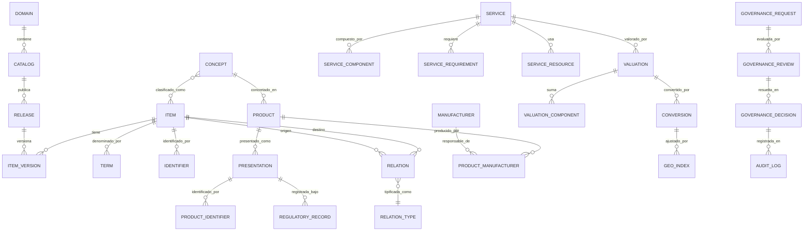

# Propuesta de arquitectura extensible de catálogos y nomencladores de Origen Salud

> **Estado: documento de auditoría, análisis y diseño. Propuesta para aprobación.**
>
> Revisión del 2026-11-19. Supersede la versión del 2026-11-18, cuyos diagnósticos
> estaban parcialmente desactualizados. Segunda revisión del 2026-11-19 tras la
> verificación de solo lectura ejecutada contra `origen_codes` en el VPS
> (PostgreSQL 18.6): las contradicciones 1 a 3 del §1.6 quedan **resueltas con
> evidencia de base de datos**. Tercera revisión del 2026-11-19: el usuario
> autorizó y ejecutó el artefacto `nomenclador_odontologico_nacional.sql`, con
> backup previo y verificación posterior; el Nomenclador Odontológico Nacional
> quedó **desplegado** (§5.2).
>
> Esta auditoría no ejecutó migraciones ni modificó importadores, endpoints ni
> contratos de API, no renombró códigos y no realizó commits, push ni deploy. La
> verificación inicial consistió únicamente en `SELECT`
> (`consultas-verificacion-1.6.sql`). La única carga posterior fue el artefacto
> del Nomenclador, ejecutada por el usuario con autorización explícita. Ninguna
> otra extensión propuesta en este documento se considera aprobada: toda
> implementación requiere aprobación explícita previa.
>
> El registro de decisiones multilingüe (`decisiones-arquitectura-multilingue.md`,
> D-01 a D-41) sigue siendo la referencia de coherencia en materia de idioma,
> procedencia y publicación. La verificación demostró que **la capa multilingüe
> sí fue ejecutada** y que D-19 tiene 419 aprobaciones registradas, pero no
> incorpora un acta formal que fije el estatus organizativo del resto de las
> decisiones. Ver §1.6.

---

## Índice

1. [Diagnóstico de la arquitectura actual](#1-diagnóstico-de-la-arquitectura-actual)
2. [Arquitectura objetivo](#2-arquitectura-objetivo)
3. [Modelo conceptual](#3-modelo-conceptual)
4. [Diagrama entidad-relación](#4-diagrama-entidad-relación)
5. [Catálogos existentes y propuestos](#5-catálogos-existentes-y-propuestos)
6. [Clasificación de los dominios](#6-clasificación-de-los-dominios)
7. [Relaciones entre catálogos](#7-relaciones-entre-catálogos)
8. [Modelo de productos, presentaciones e identificadores](#8-modelo-de-productos-presentaciones-e-identificadores)
9. [Modelo de terminologías externas y mapeos](#9-modelo-de-terminologías-externas-y-mapeos)
10. [Modelo de valoración UVR](#10-modelo-de-valoración-uvr)
11. [Estrategia de versionado](#11-estrategia-de-versionado)
12. [Estrategia de internacionalización](#12-estrategia-de-internacionalización)
13. [Diseño de API](#13-diseño-de-api)
14. [Compatibilidad con FHIR](#14-compatibilidad-con-fhir)
15. [Riesgos y decisiones pendientes](#15-riesgos-y-decisiones-pendientes)
16. [Plan de migración gradual](#16-plan-de-migración-gradual)
17. [Recomendaciones de implementación por etapas](#17-recomendaciones-de-implementación-por-etapas)
- [Apéndice A — Propuesta de navegación y arquitectura de información](#apéndice-a--propuesta-de-navegación-y-arquitectura-de-información)

---

## 1. Diagnóstico de la arquitectura actual

### 1.1 Criterio de evidencia

La auditoría de repositorio fue de solo lectura. El 2026-11-19 se añadió una
verificación también de solo lectura contra `origen_codes` en el VPS. Para no
afirmar más de lo verificable, cada hecho se etiqueta así:

| Etiqueta | Significado |
|---|---|
| **[REPO]** | Verificado directamente en archivos del repositorio. |
| **[BD]** | Verificado en `origen_codes` el 2026-11-19 mediante consultas `SELECT`. |
| **[DOC]** | Afirmado por documentación previa; contrástese con [BD] cuando exista. |
| **[PROP]** | Propuesto en este documento o en SQL no ejecutado; no implementado. |
| **[CONF]** | Contradicción entre fuentes; requiere decisión antes de cualquier cambio. |

La base de trabajo correcta es **`origen_codes`**, confirmada por [BD] (`base =
origen_codes`, PostgreSQL 18.6). `origen_salud` es la base antigua y conserva
restos aislados del primer intento de carga AN/CL; no debe usarse como
referencia [DOC].

### 1.2 Inventario verificado [REPO]

| Superficie | Conteo / estado |
|---|---|
| Archivos `.sql` bajo `sql/` | **44**, en 9 subdirectorios |
| Directorios `sql/` | `01_schema`, `02_catalogs`, `03_dentar`, `04_pmo`, `05_loinc.sql`, `06_nomencladores`, `07_multilingue`, `08_arquitectura`, `portal` |
| Generadores Python en `tools/` | 4 (`generate_dental_sql.py`, `generate_unified_catalog_engine_sql.py`, `generate_dentar_core_sql.py`, `generate_nomenclador_odontologico_sql.py`) |
| Importadores PHP en `tools/php/` | 17, más 36 artefactos en `tools/sources/` |
| Documentos en `docs/architecture/` | 12 |
| Catálogos de traducción activos | `messages.es-AR.yaml`, `messages.en.yaml`, `messages.pt-BR.yaml`: **1101 claves planas cada uno**, paridad exacta (293 `docs.*`, 249 `uvr.*`) |
| Catálogo legacy | `messages.es.yaml`: 454 claves, 94 `docs.*`, sin bloque `uvr`; `es` se canonicaliza a `es-AR` y no se carga en rutas públicas |
| API | 30 patrones de ruta: `/health` público + 29 bajo `/v1`; 30 operaciones `GET` en OpenAPI 3.1 |
| OpenAPI | `docs/api/openapi-3.1.yaml`: 30 paths, 30 operaciones, 98 `$ref`; sin `/fhir` |
| Tests | `php tests/run.php` → `OK: 2345 comprobaciones.` |

### 1.3 Cuatro generaciones conviviendo [REPO]

1. **Esquema base y tablas planas** (`sql/01_schema/design.sql`,
   `sql/06_nomencladores/`): SNOMED, CIE-10, nomencladores, vademécum,
   `api_clients`.
2. **Motor canónico `os_*`** (`sql/02_catalogs/origen_catalog_engine.sql`):
   17 tablas de catálogos, terminologías, precios y farmacia, sin funciones,
   triggers ni vistas propias.
3. **Capa aditiva multilingüe** (`sql/07_multilingue/01..18`): 6 tablas nuevas,
   columnas, triggers y funciones de hash/auditoría, más servicios PHP de
   resolución editorial. Según documentación operativa, ejecutada en
   `origen_codes` con datos de prueba y con el corte Fase 13 preparado pero
   **no activo** (`OS_IMPORT_MODE=dual`) [DOC].
4. **Capa arquitectura propuesta** (`sql/08_arquitectura/fase1..fase6`): DDL para
   registro de dominios, relaciones/mapeos, gobernanza, productos y UVR.
   **No ejecutada**; su README prohíbe ejecutarla sin aprobación [REPO].

A esto se suman las páginas standalone `web/docs.php` y `web/uvr.php`, que no
pasan por `portal/Router.php`.

### 1.4 Lo que ya resuelve la arquitectura actual [REPO]

- **Núcleo de catálogos:** `os_catalog`, `os_catalog_release`,
  `os_catalog_item`, `os_catalog_item_version`, `os_catalog_term`,
  `os_catalog_identifier`, `os_catalog_category`, `os_catalog_language`.
- **Versionado y vigencia:** release por catálogo con `valid_from`/`valid_to`,
  estados, `permanent_code` estable y retiro por estado, no por borrado.
- **Multilenguaje:** `os_language`, `os_language_alias`, `os_localized_text`,
  `os_translation_review`, `os_field_review`, más `LanguageResolver`,
  `EditorialEvaluator`, `EditorialResult`, `FieldReviewRepository`,
  `MappingReviewReader` y `LoincSourceLanguage`.
- **Mapeos:** `os_concept_mapping` registra sistemas, códigos, tipos y estado de
  revisión, con dual-read editorial.
- **Farmacia:** cadena
  `os_substance → os_medicinal_product → os_product_package →
  os_product_identifier`, antecedente directo del modelo de §8.
- **Precios:** `os_pricing_unit`, `os_fee_schedule`, `os_fee_item` y
  `os_pricing_values`, con tres componentes `*_rvu`, `conversion_factor` y
  `estimated_payment`; sin FK ni `INSERT`, vacía y desconectada.
- **Terminologías externas:** SNOMED CT (`snomed_*`, `sct2.*`), CIE-10, LOINC,
  ANMAT, nomencladores argentinos y PMO con estructuras nativas.
- **Editorial DENTAR:** `dentar_catalog`, `dentar_concept(_version)`,
  `dentar_diagnosis(_version)`, términos, categorías, mapeos y columnas de
  valoración relativa.
- **API y documentación:** envelope `data`/`meta`/`request_id`, autenticación
  Bearer/X-API-Key, paginación, OpenAPI 3.1 y suite de 2345 comprobaciones.
- **Portal:** trilingüe, con cabeceras hreflang, selector de idioma y página
  DENTAR con identidad visual propia.

### 1.5 Duplicaciones, inconsistencias y limitaciones [REPO]

1. **Dos motores de catálogo paralelos.** `CatalogEngineService` (API) y
   `CatalogRepository` (portal) duplican whitelists y bloques SQL. Agregar un
   dominio exige tocar ambos, más rutas y documentación. No hay registro único
   ni autodescubrimiento.
2. **El catálogo se expande por constantes, no por datos.** La whitelist de
   Browse tiene 12 dominios fijos y la de DENTAR está escrita en código.
3. **Mapeos dispersos.** Conviven `dentar_concept_mapping`,
   `dentar_diagnosis_mapping`, `os_concept_mapping`, `loinc_map` y columnas como
   `codigo_loinc` en `nomencladores_argentina`.
4. **`os_catalog_relation` no pertenece al motor canónico, pero sí está cargada.**
   No aparece en `origen_catalog_engine.sql` ni en su generador; su único DDL
   versionado está en `nomenclador_odontologico_nacional.sql:534-559`, archivo
   rotulado "NO EJECUTADO" [REPO]. La verificación [BD] demostró lo contrario en
   la base: **333 filas, 303 pares, 15 tipos** (§1.6-1). Conserva un `CHECK`
   cerrado a 15 tipos y 4 campos de origen, y `CatalogRepository::itemRelations()`
   no la consume, así que **sigue sin ser navegable** en Browse [REPO].
5. **Valoración fragmentada.** Valores en columnas `dentar_*`, en
   `os_fee_schedule`, en `nomencladores_argentina` y en `pmo_precios`. Sin modelo
   UVR unificado ni conversión monetaria versionada.
6. **Contrato documental divergente.** La OpenAPI existe, pero acumula 17
   desvíos frente al código (§13.2). `README-API.md` afirma UUID en
   `X-Request-Id`, `403`/`429`, `cie10_type` con valores inexistentes y
   `/v1/domains` con `code` en vez de `id`.
7. **Seguridad pendiente.** API keys en texto plano; `rate_limit_per_second` se
   lee pero no se aplica; no hay `403` ni `429`; no hay OAuth, JWT ni scopes;
   no hay rotación, expiración ni consola self-service.
8. **FHIR documentado pero no implementado.** No hay cadena `/fhir` en `api/`;
   el guardia de autenticación cubre solo `/v1/`.
9. **Deuda documental DENTAR.** `docs/dentar/README.md` da por verificada la
   carga AN/CL y CDT, mientras los SQL generados dicen "NO EJECUTADO"; los
   resúmenes generados son dry-run.
10. **Definiciones duplicadas.** `nomencladores_argentina` y
    `vademecum_comercial` se definen tres veces cada una
    (`design.sql:310/:344`, `engine:7594/:7614`, `06_nomencladores:19/:50`), con
    seeds e índices distintos: gana la primera que se ejecute.
11. **`CHECK` cerrados: laguna estructural.** `domain_type` (7), `product_role`
    (2), `mapping_type` (5), `entity_type` (12), `relation_type` (15) y otros son
    enumeraciones en el DDL. Agregar un dominio o un tipo exige modificar una
    restricción, no insertar una fila.
12. **FKs ausentes en puntos de unión.** `os_pricing_values.catalog_code`,
    `os_catalog.family_code`, `loinc_map.loinc`,
    `vademecum_comercial.anmat_certificado`, `os_translation_review.target_id`,
    `os_localized_text.entity_id` y `os_field_review.target_id`.
13. **Gobernanza de mapeos degradada.** `os_concept_mapping.review_status` tiene
    `DEFAULT 'approved'` (`engine:130`) y el sync no asigna la columna, así que
    los mapeos entran aprobados sin revisión. El cambio a `draft` existe solo en
    `fase3_relaciones_mapeos.sql`, no ejecutado.
14. **Sin control de solapamiento de vigencias.** Ninguna tabla con
    `valid_from`/`valid_to` tiene `EXCLUDE` con `&&` sobre `tstzrange`.
15. **Releases desvinculados.** `dentar_release` y `os_catalog_release` no tienen
    columna de correspondencia; el sync reconstruye el release desde la versión
    máxima.
16. **Pérdida potencial de texto.** El sync aplica `left(...,255)` a términos de
    `dentar_term.term VARCHAR(500)` y a `preferred_term`; PR borra términos antes
    de insertar y DX solo inserta, con `os_catalog_term` sin `UNIQUE`.
17. **Orden y duplicación en SQL DENTAR.** `dentar_core_and_diagnosis.sql:20`
    indica ejecutarlo antes de `dentar_family.sql`, pero `:28-35` exige que
    `dentar_catalog` ya exista. Dos triggers se definen en ambos archivos.
18. **Generadores desincronizados.** `generate_dentar_core_sql.py` emite
    `DNT-000001` y `DNT-DX-0001..0038`, mientras el SQL versionado contiene
    `DNT-PR-000001..000138` y `DNT-DX-000000..000038`; el generador sobrescribe
    el artefacto. Tres generadores leen `sql/odontologico.sql`, que no existe
    (la fuente real está en `tools/sources/odontologico/`).
19. **Mapeos PMO rotos.** `pmo.sql:107-122` referencia `DNT-PR-010101` y otros
    códigos que no existen en el núcleo; la validación es un placeholder.
20. **Importadores incompletos.** `import_dentar_csv.php` solo acepta PR/DX y
    fija `'es-AR'` literalmente; AN/CL no pueden recargarse. La compuerta
    `OS_IMPORT_MODE` se invoca solo en DENTAR; RF2 y nomencladores hacen `bind()`
    sin `assertWritableMode()`. `import_nomenclador_csv.php` es idempotente
    pero no usa la compuerta. El verificador Fase 10 reporta 339 hallazgos.
21. **LOINC destructivo.** `importar_loinc.sql:68,117` ejecuta
    `DROP TABLE ... CASCADE` y depende de CSV externos; sobrescribe campos en
    español con capas es-MX/es-AR.
22. **Rutas y permisos.** `01_schema/README.md` y varios README citan rutas SQL
    en la raíz de `sql/` que no existen. `sql/portal/01_origen_med_permisos.sql:15`
    crea un rol con contraseña literal de ejemplo, y el script `02` repite GRANTs
    ya otorgados.
23. **Standalone sin integración.** `/search` usa canónica `/search` pero
    `I18n::alternateLinks()` genera alternativas `/{locale}/search` que no
    existen en el router; `/uvr` no está en el sitemap.

### 1.6 Contradicciones: resolución y evidencia

**Método.** Las contradicciones 1 a 3 se verificaron en el VPS el 2026-11-19 con
el script de solo lectura
[`consultas-verificacion-1.6.sql`](consultas-verificacion-1.6.sql), ejecutado como
`sudo -u postgres psql -d origen_codes -v ON_ERROR_STOP=1 -P pager=off -f …`.
Entorno: `base=origen_codes`, `usuario=postgres`, PostgreSQL 18.6. Las
contradicciones 4 a 6 se resolvieron en el repositorio.

| # | Resolución | Evidencia |
|---:|---|---|
| 1 | **Resuelta. Gana [DOC].** Los números son reales en la base: `dentar-pr` 844, `dentar-dx` 223, `dentar-an` 624, `dentar-cl` 218; 333 relaciones / 303 pares / 15 tipos; 805 identificadores `CDT-2025`. El SQL versionado (138 PR / 38 DX, artefacto "NO EJECUTADO") describe un **seed parcial**, no el estado de `origen_codes`. La fuente canónica de códigos es la base alimentada por importadores y artefactos generados, no el seed. | [BD] bloques 1A–1E. `dentar_concept` 1686 = 844 + 624 + 218; `dentar_diagnosis` 223 = DX. |
| 2 | **Resuelta en cuanto a ejecución. Gana [DOC/b].** La capa multilingüe sí está ejecutada: tablas/columnas/triggers/vista de los scripts 01, 04, 05, 07 y 09 presentes; 5 idiomas y 2 alias sembrados; 419 aprobaciones D-19 registradas el 2026-11-17. La afirmación de "cero ejecución y cero aprobación" queda refutada. **Sigue pendiente el acta formal** que declare el estatus organizativo de D-01..D-41: una huella en base no equivale a ratificación documental. | [BD] bloques 2A–2D. |
| 3 | **Resuelta en cuanto a datos. Gana [DOC/a].** AN/CL están cargados: 624/218 ítems, 1248/436 versiones (dos idiomas por ítem), 624/218 identificadores, 0 mapeos, términos en `es-AR` y `en` con `is_primary` del código DENTAR. Las relaciones CDT también están cargadas. El cartel "NO EJECUTADO" de los artefactos es información del repositorio, no de la base. **Sigue pendiente la decisión editorial** de publicar o no AN/CL: hoy Browse los muestra como "No publicado", lo cual es una decisión de exposición, no una ausencia de datos. | [BD] bloques 1E y 3A–3C. |
| 4 | **Resuelta.** El inventario correcto es **44** archivos `.sql` en 9 subdirectorios. | [REPO] `find sql -type f -name '*.sql'`. |
| 5 | **Resuelta por edición.** La revisión actual distingue [REPO] de [DOC] y no afirma ejecución sin evidencia. | [REPO] §1.3 y esta sección. |
| 6 | **Resuelta. Verificador canónico: `tests/run.php`** (`OK: 2345 comprobaciones`), que cubre API, portal y páginas standalone. `tools/php/verificar_fase10.php` queda como **informe legacy**: sus 339 hallazgos son reproducibles y exigen 94 claves `docs.*` en `messages.es.yaml`, catálogo no cargado en rutas públicas (454 claves totales, 94 `docs.*`); los catálogos activos tienen 1101 claves y 293 `docs.*`. No debe usarse como puerta de calidad sin decidir antes si se migra su expectativa al catálogo activo. | [REPO] ejecución de ambos verificadores y conteo YAML. |

### Hallazgos nuevos derivados de la verificación

1. **`os_catalog_language` está vacío (0 filas)** [BD]. Los idiomas existen en
   `os_language`, pero ningún catálogo declara `is_default`/`is_fallback`/
   `is_bridge`. La resolución idiomática depende hoy de defaults globales, no de
   configuración por catálogo.
2. **D-31 no está activo** [BD]: el trigger `trg_ocm_invalidate_fr` (script 18)
   está ausente, aunque el resto de la huella multilingüe existe. La
   invalidación de aprobaciones por cambio de contenido no está operativa.
3. **Ninguna capa LOINC tiene `review_status='approved'`** [BD] (0 de
   1.303.888 filas entre `Loinc.csv`, `ConsumerName.csv` y las variantes es-MX /
   es-AR). Es coherente con la regla de no inventar aprobaciones, pero implica
   que el dual-read editorial no serviría texto LOINC como aprobado.
4. **Las 419 aprobaciones D-19 cubren solo `os_concept_mapping`** [BD]: los
   419 eventos `approval_granted` y sus 419 `content_changed` apuntan a mapeos,
   no a catálogos, términos ni UVR. No deben interpretarse como aprobación
   general de la arquitectura.
5. **El Nomenclador Odontológico Nacional estaba ausente y ya fue desplegado**
   [BD]. La verificación inicial encontró 11 catálogos sin
   `nomenclador-odontologico-ar`, solo 138 + 138 identificadores secundarios
   sobre DENTAR-PR. El 2026-11-19, con autorización explícita y backup previo, el
   usuario ejecutó `sql/03_dentar/nomenclador_odontologico_nacional.sql`: el
   inventario pasó a **12 catálogos**, con **135 ítems**, **135 versiones
   `es-AR`** y **270 relaciones `referencia_literal`** nuevas. Las 333 relaciones
   CDT quedaron intactas. Detalle y verificación en §5.2.
6. **El corte Fase 13 no está activo** [BD + REPO]. `sudo -u www-data printenv
   OS_IMPORT_MODE` devolvió vacío, así que no hay override de entorno. En el
   código, `ImporterIdentity::mode()` usa `OS_IMPORT_MODE` con default **`dual`**
   (`tools/php/ImporterIdentity.php:39-40`) y `assertWritableMode()` bloquea
   explícitamente `new_only` hasta la Fase 13 aprobada (`:54-59`). El modo
   efectivo es `dual`. Queda como comprobación optativa revisar la configuración
   del pool de PHP-FPM por si allí se inyectara la variable.

### Regla resultante

Las contradicciones factuales están cerradas, incluidas las dos comprobaciones
finales del 2026-11-19: catálogo nacional ausente (ya desplegado por decisión
del usuario) y corte `dual` no activo. Solo permanecen decisiones organizativas:
el acta de D-01..D-41, la publicación de AN/CL, la activación de D-31, el
llenado de `os_catalog_language` y la fuente de los primeros valores UVR.
Ninguna de esas decisiones se asume aquí; ninguna se usa como base para DDL,
DML, publicación o cambio de contrato.

---

## 2. Arquitectura objetivo

### 2.1 Principios

1. **Identidad propia.** DENTAR conserva nombre completo, marca, códigos,
   releases y gobernanza. Cada catálogo conserva su identidad y su sistema de
   origen.
2. **Infraestructura compartida.** Un solo registro de dominios/catálogos, un
   solo motor de consulta, un solo modelo de relaciones, versionado, idioma,
   auditoría y documentación.
3. **Extensibilidad real.** Incorporar un dominio es insertar datos y, si hace
   falta, crear un módulo específico con FK al núcleo; nunca rediseñar el núcleo
   ni crear una implementación paralela.
4. **Separación de planos.** Datos maestros, terminologías externas, productos
   comerciales y valoración económica son planos distintos.
5. **Aditividad.** Se prohíbe `DROP TABLE`, `DROP COLUMN`, `TRUNCATE` y `DELETE`
   de datos; solo se permite eliminar índices inválidos (D-34), con aprobación.
6. **Procedencia.** Toda fila publicable declara fuente, versión, licencia,
   responsable y estado de revisión. Sin evidencia: `unknown`/`NULL`, nunca
   `approved`.
7. **No duplicación.** Un concepto se representa una vez; las especializaciones
   se expresan como relaciones tipificadas, no como copias.

### 2.2 Capas

```
Registro de dominios y catálogos (datos)  → os_domain_registry, os_catalog
Núcleo de catálogos y versionado          → release, item, versión, término, identificador
Terminologías externas (nativas)          → snomed_*, cie10_*, loinc*, ANMAT, CDT, NN
Relaciones y mapeos tipificados           → os_catalog_relation + metadatos
Productos, presentaciones, regulatorio    → os_concept → os_product → presentación
Prestaciones y servicios                  → os_service + componentes/requerimientos
Valoración relativa y conversión          → os_uvr_*, separado de aranceles
Gobernanza y auditoría                    → requests, reviews, decisions, audit_log
Proyecciones                              → API REST, portal, OpenAPI, FHIR, exportadores
```

### 2.3 Regla de oro

Un **catálogo es una fila con releases**, no una tabla. Una **extensión de
dominio es un módulo con FK**, no una tabla polimórfica gigante que mezcle
procedimientos, diagnósticos, productos y precios.

---

## 3. Modelo conceptual

| Entidad | Identidad | Atributos clave | Relaciones |
|---|---|---|---|
| `Domain` | `domain_code` | etiqueta i18n, clase | 1:N `Catalog` |
| `Catalog` | `catalog_code` | familia, rol (`family`/`catalog`), propietario | N:1 `Domain`, 1:N `Release` |
| `Release` | `release_id` | `version_tag`, vigencia, estado | N:1 `Catalog`, 1:N `ItemVersion` |
| `Item` | `permanent_code` | código estable, estado | 1:N `ItemVersion`, `Identifier`, `Term` |
| `ItemVersion` | `(item, release, language)` | contenido, `content_hash`, `review_status` | 1:N `Term` |
| `Term` | `term_id` | preferido/sinónimo, idioma, fuente | N:1 `ItemVersion` |
| `Identifier` | `system + value` | `is_primary`, vigencia | N:1 `Item` |
| `Concept` | `concept_id` | tipo de concepto | 1:N `Product` |
| `Product` | `product_id` | marca, modelo | N:1 `Concept`, 1:N `Presentation` |
| `Presentation` | `presentation_id` | envase, talle, concentración | 1:N `Identifier` |
| `Manufacturer` | `manufacturer_id` | razón social, país | N:M `Product` con rol |
| `RegulatoryRecord` | `record_id` | autoridad, número, vigencia | N:1 `Presentation`/`Product` |
| `Service` | `service_id` | prestación/procedimiento | componentes, requerimientos, recursos |
| `Valuation` | `valuation_id` | metodología, release, revisión | 1:N `ValuationComponent` |
| `Conversion` | `conversion_id` | país, jurisdicción, financiador, período | 1:N `GeoIndex` |
| `Relation` | `relation_id` | tipo, vigencia, método, confianza | extremos con sistema/versión/código |
| `GovernanceRequest` | `request_id` | solicitante, motivo | reviews → decisions → audit |

Distinciones obligatorias:

- **Identidad ≠ código ≠ denominación ≠ idioma ≠ jurisdicción ≠ vigencia.**
  Cambiar denominación o idioma **no** genera código nuevo.
- **Concepto ≠ producto ≠ presentación ≠ identificador ≠ fabricante.**
- **Prestación ≠ valoración ≠ conversión ≠ arancel ≠ contrato de financiador.**

---

## 4. Diagrama entidad-relación

Diagrama lógico de la arquitectura objetivo (Mermaid). Las tablas con prefijo
`os_` que no existen hoy están marcadas como `[PROP]` en el §5 y §16.



La proyección FHIR (§14) se deriva de este modelo; no define tablas nuevas.

---

## 5. Catálogos existentes y propuestos

### 5.1 DENTAR: dominio prioritario

Nombre completo: **Catálogo Argentino de Procedimientos Odontológicos**.
Es iniciativa propia de Origen Salud con proyección latinoamericana; **no** es
nomenclador oficial del Estado argentino ni estándar internacional.

| Código | Nombre | Estado |
|---|---|---|
| `DENTAR-PR` | Procedimientos | **844 ítems [BD]**; activo, consultable en Browse y API |
| `DENTAR-DX` | Diagnósticos | **223 ítems [BD]**; activo, consultable en Browse y API; **sin UVR ni facturación** |
| `DENTAR-AN` | Anatomía | **624 ítems [BD]**, `es-AR` + `en`; visible como "No publicado" en Browse por decisión editorial |
| `DENTAR-CL` | Clínica | **218 ítems [BD]**, `es-AR` + `en`; visible como "No publicado" en Browse por decisión editorial |
| `DENTAR-IN` | Insumos y materiales | **Propuesto**; reservado, sin códigos aprobados |
| `DENTAR-PD` | Productos odontológicos | **Propuesto**; reservado |
| `DENTAR-EQ` | Equipamiento | **Propuesto**; reservado |

Formatos reales verificados [BD]: `DNT-PR-NNNNNN` (844), `DNT-DX-NNNNNN` (223),
`DNT-AN-NNNNNN` (624) y `DNT-CL-NNNNNN` (218). No usar los códigos inventados
`DNT-000007` que aparecen en documentación antigua. Las relaciones se conservan
literales, sin asumir equivalencias clínicas; hay 333 filas verificadas [BD].

Reglas: separar concepto de insumo y producto comercial (§8); AN permite
piezas, superficies y regiones; CL representa hallazgos y condiciones; las
relaciones entre catálogos son explícitas, tipificadas, versionadas y
auditables.

### 5.2 Nomenclador Odontológico Nacional

El generador `tools/generate_nomenclador_odontologico_sql.py` produce
`sql/03_dentar/nomenclador_odontologico_nacional.sql`, con catálogo
`nomenclador-odontologico-ar`, release `NOM-ODON-AR-v1`, sistema
`NOMENCLADOR-AR`, identificador secundario `NOMENCLADOR_AR` e idioma `es-AR` [REPO].

El artefacto llevaba el rótulo **"NO EJECUTADO. Requiere autorización explícita
para DDL, carga y deploy"** [REPO]. La verificación inicial [BD] encontró 138
identificadores `NOMENCLADOR-AR` y 138 `NOMENCLADOR_AR` sobre ítems DENTAR-PR
pero ningún catálogo (§1.6, hallazgo 5). El 2026-11-19 el usuario autorizó y
ejecutó la carga con backup previo (`/tmp/origen_codes-pre-nomenclador-2026-11-19.dump`)
y `ON_ERROR_STOP=1`; el artefacto terminó en `COMMIT` [BD].

**Resultado verificado [BD]:**

| Comprobación | Resultado |
|---|---|
| Catálogos en `os_catalog` | 12 (antes 11); se añadió `nomenclador-odontologico-ar` |
| Ítems del catálogo | **135**, con numeración original (`01.01`, `11.02`, …) |
| Versiones | **135** en `es-AR`; no se generó versión `en` |
| Categorías y release | 21 categorías; release `NOM-ODON-AR-v1`, `status='published'`, `valid_from=CURRENT_DATE` (fecha de carga, no normativa) |
| Atributos literales | 2700 (10 indicadores × 135 ítems + mapeos DENTAR) |
| Identificadores | 138 `NOMENCLADOR_AR` sobre DENTAR-PR (actualizados) y 135 `DENTAR-PR` sobre ítems nacionales |
| Relaciones nuevas | **270** `referencia_literal` con `source_system_code='NOMENCLADOR-AR'` (135 × 2 sentidos) |
| Relaciones CDT preexistentes | **333 intactas** (`CREATE TABLE IF NOT EXISTS` e `INSERT` acotado) |

El preflight confirmó 237 mapeos `dentar_concept_mapping` con
`system_code='NOMENCLADOR-AR'` para 138 códigos distintos: los 135 códigos del
dump quedaron vinculados y los 3 restantes no se inventaron. El código visible
de DENTAR-PR sigue siendo principal; el nacional es secundario y se relaciona
por `referencia_literal`, sin juicio de equivalencia clínica. El portal ya
incluye el catálogo en `CatalogRepository::DENTAR_CATALOGS` y en la vista de
Browse [REPO], por lo que es consultable sin cambios de código; las relaciones
siguen sin ser navegables mientras `itemRelations()` no consuma la tabla [REPO].

### 5.3 Catálogos generales propuestos (OS-*)

| Código propuesto | Nombre | Evaluación |
|---|---|---|
| `OS-INS` | Insumos sanitarios | Útil como concepto general; vigilar solapamiento con `DENTAR-IN` |
| `OS-PROD` | Productos sanitarios | Solapa con `OS-DIS` y `OS-MED`; conviene una sola familia con clasificación |
| `OS-MED` | Medicamentos | Justificado por su regulación y modelo propio |
| `OS-DIS` | Dispositivos médicos | Justificado; dominio UDI/regulatorio |
| `OS-EQP` | Equipamiento | Solapa parcial con `DENTAR-EQ` |
| `OS-IMPL` | Implantes y prótesis | Solapa con `OS-DIS`; tratar como especialización |

**Recomendación:** no adoptar los seis como catálogos independientes sin más.
Proponer una familia `OS-PRODUCTS` con dominios clasificados
(`consumable`, `medicine`, `device`, `equipment`, `implant`) y los códigos
`OS-*` como etiquetas reservadas, salvo decisión en contrario. Así se evita
duplicar un mismo guante en `OS-INS`, `OS-DIS` y `DENTAR-IN`.

### 5.4 Terminologías y sistemas externos presentes

SNOMED CT Argentina (`sct2.*`, `snomed_*`), CIE-10, LOINC, ANMAT,
Nomenclador Argentino, CDT 2025, NN/NBU/PMO y vademécum. Conservan su sistema
de origen, versión oficial y licencia. Origen Salud no es su autor [REPO].

### 5.5 Visibilidad pública actual [REPO]

- **Consultables en Browse:** `dentar-pr`, `dentar-dx`,
  `nomenclador-odontologico-ar`.
- **Visibles como "No publicado":** `DENTAR-AN`, `DENTAR-CL`.
- **Visibles como "Propuesto":** `DENTAR-IN/PD/EQ` y los seis `OS-*`.
- **Documentados en Docs pero sin filtro Browse:** `nbu`, `nn-pmo`, `nhpgd`,
  `andis`, `kinesiologia`, `salud-mental` [DOC].
- **Excluidos del sitemap:** reservados, UVR y `/cart`.

---

## 6. Clasificación de los dominios

La clasificación es una dimensión de la arquitectura, no una tabla nueva por
dominio.

| Clase | Definición | Ejemplos | Tratamiento |
|---|---|---|---|
| Catálogo propio | Gobernado por Origen Salud | DENTAR-PR/DX/AN/CL | Releases, comité, códigos permanentes |
| Familia propia | Marca paraguas sin códigos propios | DENTAR, futura `OS-PRODUCTS` | `os_catalog` rol `family` |
| Terminología externa | Propiedad de terceros | SNOMED CT, CIE-10, LOINC | Tablas nativas + licencia + versión oficial |
| Nomenclador nacional/jurisdiccional | Uso regulatorio o convencional | Nomenclador Argentino, CDT 2025, NN 2025 | Procedencia y vigencia explícitas |
| Clasificación regulatoria | Registro, habilitación, categoría | ANMAT, UDI, registro sanitario | `os_regulatory_records` |
| Identificador comercial | GTIN, UDI, código de fabricante | Productos y presentaciones | `os_product_identifiers` |
| Valoración económica | UVR y conversiones | SVP | Módulo aislado, versionado |
| Arancel / lista de precios | Decisión de un financiador | `os_fee_schedule`, PMO | No confundir con valoración relativa |

Regla de oro: **la clase determine el tratamiento, no la forma de la tabla.**

---

## 7. Relaciones entre catálogos

### 7.1 Fundamento

Los 15 tipos reales de CDT incluyen `referencia_literal`, `refer_to_details`,
`denied_as_integral`, `used_in_combination_with` y `billed_in_conjunction_with`
[DOC]. No deben aplanarse a `related`: para eso ya existe `os_concept_mapping`,
que pierde el contexto. El tipo debe referenciar `os_relation_type`, no un
`CHECK` cerrado.

### 7.2 Modelo propuesto

Mantener `os_catalog_relation` como tabla de relaciones entre ítems y extenderla
de forma aditiva:

- `relation_id` (PK), `valid_from`/`valid_to`;
- `source_catalog_id`/`source_release_id` y `target_catalog_id`/
  `target_release_id` para versionar ambos extremos;
- `relation_kind` (`structural`, `clinical`, `editorial`, `billing`,
  `regulatory`, `mapping`) sin perder el tipo específico;
- `mapping_method`, `confidence_level`, `reviewed_by`, `reviewed_at`,
  `license_reference`;
- `inverse_relation_type` opcional para navegación inversa.

Tipos del prompt a incorporar **cuando haya evidencia**: `related_to`,
`equivalent_to`, `broader_than`, `narrower_than`, `replaces`, `replaced_by`,
`indicated_by`, `contraindicated_by`, `requires`, `uses`, `contains`,
`classified_as`, `maps_to`. **No asignar `equivalent_to` por similitud de
nombres.** Los mapeos pueden ser unívocos, múltiples, parciales o aproximados y
deben declararlo.

### 7.3 Compatibilidad de exportación

Conservar `related_dentar` y `related_external` como vistas o proyecciones sobre
la tabla relacional normalizada, sin romper formatos existentes.

### 7.4 Pendiente inmediato

Integrar `CatalogRepository::itemRelations()` con `os_catalog_relation` para que
las 333 relaciones CDT verificadas [BD] sean navegables. La contradicción §1.6-1
ya está resuelta; requiere aprobación para el cambio de código.

---

## 8. Modelo de productos, presentaciones e identificadores

### 8.1 Separación obligatoria

```
Concepto (guante de examen)
   └── Producto comercial (guante de nitrilo, marca X, fabricante Y)
          └── Presentación (caja de 100, talle M)
                 ├── GTIN
                 ├── UDI (si aplica)
                 ├── Código de fabricante
                 └── Registro sanitario
```

### 8.2 Tablas propuestas

| Tabla | Contenido |
|---|---|
| `os_concept` | Concepto general; `concept_kind`, `domain_type`, `permanent_code` |
| `os_product` | Producto comercial; `concept_id`, `brand`, `model`, `manufacturer_id` |
| `os_product_presentation` | Presentación; `product_id`, `pack_size`, `size`, `form`, `concentration` |
| `os_product_identifier` | `identifier_type` (GTIN/UDI/MANUFACTURER/…), `value`, `issuing_system`, vigencia |
| `os_manufacturer` | Fabricante/titular; razón social, país, identificadores |
| `os_product_manufacturer` | Rol (fabricante, titular, importador, distribuidor) y vigencia |
| `os_regulatory_record` | Registro sanitario, autoridad, número, vigencia, licencia |

Para medicamentos, el mismo esquema se especializa con `active_ingredient`,
`concentration`, `pharmaceutical_form`, `route`, `packaging` y el registro
ANMAT correspondiente, sin confundir principio activo, producto y presentación.

### 8.3 Reglas

- Aprovechar `os_substance → os_medicinal_product → os_product_package →
  os_product_identifier` como base y generalizarla con `os_concept` y
  `os_product`. Corregir el `UNIQUE(system_code, identifier_value)` global
  (`engine:236`): debe ser por presentación para permitir GTIN legítimamente
  repetidos.
- Cambiar marca, fabricante, envase o presentación **no** genera un concepto
  clínico nuevo. Varios productos pueden apuntar al mismo concepto.
- `DENTAR-IN` (si se aprueba) especializa `OS-INS`; `DENTAR-PD` especializa la
  familia de productos; `DENTAR-EQ` especializa equipamiento. La
  especialización es una relación tipificada (`classified_as` /
  `specialization_of`), no una copia de filas.
- `fase5_productos.sql` ya propone las tablas, **sin productos cargados** y solo
  con tipos de identificador y roles semilla [REPO]. No inventar productos,
  marcas, registros sanitarios ni relaciones.

---

## 9. Modelo de terminologías externas y mapeos

### 9.1 Principios

- Cada terminología conserva su tabla nativa: `snomed_descriptions`,
  `cie10_descriptions`, `loinc_localized_text`, `odontologia_cdt_*`,
  `nomencladores_argentina`. No se reescriben sus datos originales.
- Se preservan `rf2_language_tag`, `source_file`, `source_release`,
  `module_id`, `effective_time` y licencia cuando aplica (D-05, D-08, D-22,
  D-33, D-40).
- `es` de SNOMED/CDT no se convierte en `es-AR` (D-27, D-39). `es-MX` de LOINC
  no es alias de entrada y su procedencia se declara por fila.
- Sin invención de procedencia: prohibido asignar `official_source`,
  `approved` o `source_language_code` sin evidencia; usar `unknown`/`NULL`/
  `language_evidence='undetermined'`.

### 9.2 Mapeos

Un único modelo lógico, distribuido entre `os_concept_mapping` y la extensión
propuesta `os_mapping_metadata`:

| Campo | Propósito |
|---|---|
| `source_system`, `source_version`, `source_code` | Lado origen |
| `target_system`, `target_version`, `target_code` | Lado destino |
| `mapping_type` | `equivalent_to`, `maps_to`, `broader_than`, `narrower_than`, `not_mappable` |
| `mapping_nature` | unívoco, múltiple, parcial, aproximado |
| `method` / `confidence_level` | Cómo se obtuvo y cuánto se confía |
| `source_reference` / `license_reference` | Documentación y licencia |
| `review_status` / `reviewed_by` / `reviewed_at` | Gobernanza (D-01, D-02) |
| `valid_from` / `valid_to` | Vigencia |

Dual-read: el texto traducido de un mapeo solo se sirve si está `approved`
(D-20, D-30); si no, `null` + `untranslated=true`. Corregir el
`DEFAULT 'approved'` de `os_concept_mapping` y evitar que el sync borre y
reinserte mapeos aprobados preservando estado y auditoría.

Los sistemas terminológicos están duplicados: `os_terminology_system` frente a
`dentar_terminology_system`. Unificar en un solo registro.

---

## 10. Modelo de valoración UVR

### 10.1 Fundamento metodológico

Tomado de `README-UVR.md` y de la página `/uvr`: la UVR es una **unidad de
valoración relativa propuesta por Origen Salud**. No es unidad oficial
argentina, no es arancel, no es RVU de Medicare y no es equivalente a ningún
RVU por conversión directa. No hay valores aprobados ni cargados, no hay
índices geográficos publicados y ningún endpoint consulta estas estructuras.

Fórmula canónica:

```text
total_uvr = work_uvr + practice_expense_uvr + professional_liability_uvr
```

Componentes:

| Componente | Campo | Significado |
|---|---|---|
| Trabajo profesional | `work_uvr` | Recurso de trabajo del profesional |
| Gastos de prestación | `practice_expense_uvr` | Gastos operativos |
| Responsabilidad profesional | `professional_liability_uvr` | Cobertura de responsabilidad profesional |
| Total | `total_uvr` | Suma de los tres |

Fórmulas completas (idénticas en los tres idiomas de la página `/uvr`):

```text
adjusted_work_uvr = work_uvr × uvr_geo_work_index
adjusted_practice_expense_uvr = practice_expense_uvr × uvr_geo_practice_expense_index
adjusted_professional_liability_uvr = professional_liability_uvr × uvr_geo_professional_liability_index
adjusted_total_uvr = adjusted_work_uvr + adjusted_practice_expense_uvr + adjusted_professional_liability_uvr
estimated_payment = total_uvr × uvr_value
estimated_payment = adjusted_total_uvr × uvr_value
```

### 10.2 Tablas propuestas

`fase6_uvr.sql` propone cinco tablas y la vista `v_os_uvr_valuation_total`, sin
valores cargados [REPO]:

| Tabla | Contenido |
|---|---|
| `os_uvr_valuation` | `service_item_id`, `release_id`, `methodology`, `source_reference`, `review_status`, `valid_from/to`, `version` |
| `os_uvr_component` | `valuation_id`, `component_type`, `value`, `calculation_note` |
| `os_uvr_conversion` | `uvr_value`, `currency`, `country`, `jurisdiction`, `payer`, `contract`, `period`, `index_reference`, `source_reference` |
| `os_uvr_geo_index` | `component_type`, `jurisdiction`, `index_value`, `methodology`, `source_reference`, `period` |

### 10.3 Reglas duras

1. UVR solo para procedimientos/prestaciones. **No** asignar a diagnósticos,
   productos ni insumos por defecto; `DENTAR-DX` queda sin UVR.
2. Separar valoración relativa de conversión monetaria: actualizar `uvr_value`
   por inflación **no** cambia los `*_uvr`, y revisar una prestación **no**
   cambia el `uvr_value`.
3. Histórico inmutable: nueva valoración = nueva fila, nunca `UPDATE`.
4. Índices geográficos y valores monetarios se versionan por separado. Sin
   evidencia, índices = 1.00 y valor nacional uniforme; **no inventar índices
   regionales**.
5. `estimated_payment` es derivado e ilustrativo, no un arancel vigente.
6. Fuentes verificables, fecha de evaluación, responsable, aprobación y
   justificación son obligatorios antes de publicar cualquier valor.

### 10.4 Estado actual [REPO]

Cuatro modelos de valoración simultáneos:

| Modelo | Ubicación | Problema |
|---|---|---|
| `dentar_concept_version.*_uvr` | `core:263-267` | Valores incrustados en la ficha editorial |
| `os_pricing_values.*_rvu` | `engine:181-184` | Sin FK, sin `INSERT`, vacía y desconectada |
| `os_fee_item.units_amount/fixed_price/expenses_amount` | `engine:167-169` | Modelo arancelario correcto, distinto del relativo |
| `nomencladores_argentina.unidad_tipo/unidad_valor/gastos_valor` | `design:318-320` | Proyección plana heredada |

La nomenclatura `rvu` es legado; el modelo nuevo usa `*_uvr`. No renombrar
columnas existentes ni borrar tablas: el módulo UVR se añade de forma aditiva y
se reconcilia después. No existe `/v1/uvr` ni ninguna ruta UVR.

---

## 11. Estrategia de versionado

### 11.1 Niveles

| Nivel | Mecanismo | Estado |
|---|---|---|
| Catálogo | `os_catalog_release` con `version_tag`, vigencia, estado | Existe |
| Ítem | `permanent_code` inmutable; retiro por estado | Existe |
| Contenido | `os_catalog_item_version` por `(item, release, language)` | Existe (D-04) |
| Término | `os_catalog_term` por versión e idioma | Existe, sin `UNIQUE` |
| Relación | Extensión con release de ambos extremos y vigencia | [PROP] |
| Mapeo | Extensión con versión de sistemas y vigencia | [PROP] |
| UVR | `os_uvr_valuation` por release/metodología | [PROP], no ejecutado |
| Conversión | `os_uvr_conversion` por jurisdicción/período | [PROP], no ejecutado |

### 11.2 Reglas

- Códigos no reutilizables tras retiro (`retired`, `deprecated`).
- Estados: `draft`, `in_review`, `approved`, `published`, `retired`, `obsolete`,
  más `unknown`/`unreviewed` para procedencia no demostrada (D-01).
- Nunca sobrescribir contenido: nueva versión editorial → nueva release.
- La publicación depende de `review_status='approved'`; `provenance` nunca
  decide visibilidad (D-01, D-02). No debe existir `DEFAULT 'approved'`.
- Cambiar contenido invalida la aprobación en la misma transacción
  (`content_hash`, D-31/D-41). El sync no debe borrar ni reinsertar términos o
  mapeos aprobados sin preservar estado y auditoría.
- Vincular `dentar_release` con `os_catalog_release` mediante columna de
  correspondencia.
- Añadir `EXCLUDE` con `&&` sobre `tstzrange(valid_from, valid_to)` en las
  tablas con vigencia.
- Terminologías externas: conservar versión oficial y licencia; no atribuir
  autoría a Origen Salud.

---

## 12. Estrategia de internacionalización

No proponer un modelo nuevo: **respetar D-01..D-41 como árbitro de idioma,
procedencia y publicación** hasta que exista un acta que resuelva su estatus
formal. La capa multilingüe está ejecutada [BD] y D-19 tiene 419 aprobaciones
registradas, pero eso no ratifica el resto de las decisiones (§1.6-2 y hallazgo
4). Esta propuesta **no las da por aprobadas**. `os_catalog_language` está vacío
[BD], así que la configuración por catálogo aún no existe.

Puntos clave:

- Idiomas seleccionables: `es-AR`, `en`, `pt-BR`. Alias: `es→es-AR`,
  `pt→pt-BR`. `en-*` se normaliza a `en`. `es` (SNOMED/CDT) y `es-MX` (LOINC)
  son etiquetas de origen, no seleccionables; `es-MX` no es alias de entrada.
- Resolución en portal: segmento de URL → `?lang=` → cookie `origen_locale` →
  `Accept-Language` → default; en API: `lang` → alias → `Accept-Language` con
  `q` → `API_DEFAULT_LANG` (default real `es`).
- Resolvedor de idioma separado del evaluador editorial (D-30); sin texto sin
  aprobado, aunque sea el original (D-20). Candidatos: solicitado, origen,
  `is_fallback`, `is_bridge`, `is_default` y `es-AR` global.
- `meta.available_languages`, `meta.effective_language`, `meta.field_languages`,
  `Vary: Accept-Language` y `Content-Language` condicional (D-03, D-38).
- Sin columnas `*_es`/`*_en`/`*_pt`; reutilizar `os_catalog_item_version` y
  `os_catalog_term` (D-04).
- Un cambio de idioma o denominación **no genera código nuevo**; la identidad
  es el `permanent_code`.
- Los tres catálogos activos tienen 1101 claves con paridad exacta;
  `messages.es.yaml` es legado y no se carga en rutas públicas.
- Docs y UVR usan canónica y hreflang propios con `?lang=` y selector dentro de
  la página. `/search` mezcla modelos y genera alternativas `/{locale}/search`
  inexistentes: corregir como parte de la consolidación, sin tocar contratos.
- Valores económicos y regulatorios son por jurisdicción (§10).

---

## 13. Diseño de API

### 13.1 Estado real [REPO]

API de solo lectura, prefijo `/v1`, 29 rutas `/v1` más `/health`, envelope
`data`/`meta`/`request_id`, autenticación `X-API-Key` o Bearer, CORS opcional,
paginación `limit`/`offset`, OpenAPI 3.1 y 2345 comprobaciones de tests.

- `/health` es plano: `status`, `service`, `version`, `time`, `checks`; lleva
  `X-Request-Id` solo en cabecera.
- Errores: `{error:{code,message,details?},request_id}`, con `400`, `401`,
  `404`, `405`, `500`, `503`. No se emiten `403` ni `429`. `405` incluye
  `Allow: GET, OPTIONS`; `OPTIONS` responde `204` sin autenticar.
- `request_id`: hexadecimal de 32 caracteres, o `X-Request-Id` entrante de
  8–64 caracteres `[A-Za-z0-9._-]`.
- Idioma y publicación editorial se resuelven como se describe en §12.

### 13.2 Desvíos OpenAPI ↔ código [REPO]

1. La spec solo declara `GET`; el código expone `OPTIONS 204` y `405` con `Allow`.
2. `request_id` declarado `format: uuid`; el real es hexadecimal de 32.
3. `HealthEnvelope` declara `request_id` en el body; `/health` no lo incluye.
4. `ErrorEnvelope.required` solo exige `error`, aunque siempre se emite
   `request_id`.
5. `lang` con default `es-AR` en la spec; el código usa `API_DEFAULT_LANG=es`.
6. `limit` con `maximum: 100`; el máximo efectivo por defecto es 50.
7. `q` con `maxLength: 200`; `/v1/search` valida 2–80 caracteres UTF-8.
8. `Domain` declara `code`/`metadata`; la respuesta real usa `id` y
   `label`/`description` por idioma.
9. `PaginationMeta` declara `total`; la respuesta real incluye `query`,
   `language`, `page_counts`, `returned`, `has_more`, `next_offset`, `took_ms`,
   entre otros, y no incluye `total`.
10. `SearchResult` declara `catalog`/`effective_language`; la salida real usa
    `domain`, `source`, `id`, `code` anulable, `term`, `subtitle`, `language`,
    `kind`, `score`, `metadata`.
11. `/v1/concepts/{id}` usa el componente `Sctid` con nombre `sctid`.
12. `/v1/cie10/{codigo}`: restricciones de mayúsculas distintas.
13. `/v1/pmo/practicas/{code}`: spec permite 1 dígito sin punto; la ruta exige 2.
14. `/v1/medicines/identifiers/{system}`: spec restringe cuatro sistemas; la
    ruta acepta cualquier identificador.
15. La spec documenta `404` en catálogos inexistentes; el código responde `200`
    con `data: []`.
16. Parámetros implementados no documentados: `domain`, `all`/`*`, `refset`,
    `cie10_type`, `offset`, `alfabeta`, `kairos`, `gtin`, `class`, `status`,
    `system`, `capitulo`, `cobertura_condicionada`, `atc`, `seccion`,
    `snomed`, `cie10`, `tipo`, `limit`/`offset` en concepts.
17. La spec documenta `400` en 5 operaciones; el código puede emitirlo en
    muchas más.

Además, `web/docs.php` usa `{identifier}` donde el enrutador y la spec usan
`{code}`. `README-API.md` afirma UUID, `403`/`429`, `cie10_type` inexistente y
formato de dominios divergente. La propia Docs ya documenta ocho desvíos.

### 13.3 Principios para la evolución

- La API debe **descubrirse desde datos**: `/v1/domains` y `/v1/catalogs`
  deben reflejar el registro de dominios, no constantes PHP.
- Un único motor de catálogos compartido por API y portal.
- Los recursos particulares se mantienen como especializaciones sin romper la
  estructura común.
- Contrato estable: no cambiar rutas ni campos existentes sin versión nueva;
  `/v1` sigue vigente durante la migración.
- Conciliar la OpenAPI con el código y publicar ejemplos reales de uso y error.
- Seguridad como decisiones separadas: hash de keys, rate limiting, scopes,
  rotación y consola, sin fingir que ya existen.

### 13.4 Endpoints objetivo (evaluar, no implementar aún)

Los del prompt (`/catalogs`, `/catalogs/{id}/releases`, `/items`,
`/items/{code}`, `/search`, `/mappings`, `/terminologies`, `/products`,
`/products/{id}/presentations`, `/medicines`, `/services`, `/pricing`,
`/pricing/units`) más extensiones ya existentes (`/nomenclador`, `/vademecum`,
`/loinc`, `/pmo/*`, `/odontologia/*`). Mantener las rutas actuales y añadir las
nuevas de forma aditiva.

### 13.5 No hacer

- No tocar contratos actuales sin aprobación.
- No eliminar `DNT-PR-*`/`DNT-DX-*` ni sustituirlos por códigos inventados.
- No exponer `/fhir/*` sin autenticación.
- No documentar como activo lo que está pendiente (UVR, FHIR, OAuth, escrituras,
  catálogos reservados, CDT/NN propios).

---

## 14. Compatibilidad con FHIR

### 14.1 Realidad [REPO]

`README-FHIR.md` documenta `GET /fhir/metadata`, `/CodeSystem/$lookup`,
`/ValueSet/$expand`, `/ConceptMap/$translate` y ejemplos de `Procedure`,
`Condition` y `Claim`. **No hay implementación**: no hay cadena `/fhir` en
`api/`, no hay serializadores ni dependencia FHIR, y `/fhir/*` quedaría fuera
del guardia de autenticación. La OpenAPI lo declara no implementado.

### 14.2 Mapa de recursos factibles

| Recurso FHIR R4 | Origen de datos |
|---|---|
| `CodeSystem` | `os_catalog` + `os_catalog_item` |
| `ValueSet` | `os_catalog_category` / listas por release |
| `ConceptMap` | `os_catalog_relation` + mapeos |
| `Medication` | `os_product` / medicamentos |
| `MedicationKnowledge` | registro sanitario, presentación, fabricante |
| `Device` / `DeviceDefinition` | dispositivos y equipamiento |
| `Procedure` / `ServiceRequest` | DENTAR-PR / prestaciones |
| `HealthcareService` | catálogo de servicios |
| `ChargeItem` / `ChargeItemDefinition` | UVR + conversión, **nunca como arancel oficial** |

### 14.3 Recomendación

Implementar FHIR como **capa de proyección** sobre el modelo interno, después de
consolidar el motor único y la gobernanza. No forzar FHIR donde no corresponda.
`ChargeItemDefinition` debe declarar que el importe es estimado y derivado de
UVR, no una tarifa oficial. Ajustar el guardia de autenticación antes de
exponer cualquier `/fhir/*`.

---

## 15. Riesgos y decisiones pendientes

### 15.1 Riesgos

| Riesgo | Impacto | Mitigación propuesta |
|---|---|---|
| Duplicar motores de catálogo | Divergencia API/portal | Motor único compartido |
| `CHECK` cerrados en el DDL | Cada dominio nuevo exige migración | Tablas de referencia con FK |
| Crear tabla por catálogo | Explosión estructural | Catálogos como datos + módulos específicos |
| Inventar productos/códigos | Pérdida de confianza | Prohibición explícita; `unknown` |
| Aplanar relaciones a `related` | Pérdida de tipos CDT | `os_catalog_relation` con contexto y tipo FK |
| Dar UVR a diagnósticos/productos | Error metodológico | Regla dura §10.3 |
| Confundir UVR con arancel | Riesgo legal/contractual | Separación y etiquetado de estimado |
| Copiar índices GPCI/RVU | Error económico | Solo referencia conceptual |
| Publicar texto no aprobado | Riesgo editorial | D-02, D-20, D-30 |
| Mapeos que nacen `approved` y sync que los reinserta | Aprobaciones falsas | Quitar el `DEFAULT`, preservar estado |
| Cinco modelos de términos y recorte a 255 | Pérdida de contenido | Unificar y no truncar |
| `os_pricing_values` vacío y sin FK | Valoración desconectada | Módulo UVR aditivo + FK |
| `es`→`es-AR` automático | Falsedad idiomática | D-05, D-22, D-27, D-39 |
| Implementar `/fhir` sin auth | Exposición | Ajustar guardia `/v1/` |
| Decisiones organizativas §1.6 aún no tomadas | Publicación y gobernanza sobre datos ya verificados | Acta de estado antes de DDL/DML |
| Documentar pendientes como vigentes | Desinformación | Auditoría Docs/UVR y OpenAPI |
| Migración sin backup/rollback | Pérdida de datos | Fases aditivas, backups verificados (D-16, D-25) |

### 15.2 Decisiones pendientes (requieren aprobación explícita)

1. Aprobar este documento como referencia arquitectónica, en reemplazo de la
   versión 2026-11-18.
2. ~~Resolver las seis contradicciones de §1.6~~ **Resueltas con evidencia [BD]
   y [REPO] el 2026-11-19; no requieren nueva decisión factual.**
3. Ratificar `origen_codes` como única base de trabajo y `origen_salud` como
   legado (ya verificado [BD], pendiente el acta).
4. Publicar AN/CL y las relaciones CDT, o confirmar que siguen sin publicarse
   (los datos existen [BD]; falta la decisión editorial).
5. Decidir si `DENTAR-IN`, `-PD`, `-EQ` se reservan y cuándo se crean.
6. Decidir el modelo de catálogos generales: seis `OS-*` independientes vs.
   familia `OS-PRODUCTS` con clasificación (recomendado).
7. Definir actores, roles y responsable de aprobación UVR.
8. Emitir el acta que fija el estatus formal de D-01..D-41 y autorizar su
   ejecución o activación.
9. Aprobar la corrección de la OpenAPI y de `README-API.md`. El verificador
   canónico ya quedó definido en §1.6: `tests/run.php`; decidir si se migra o se
   retira la expectativa legacy de `verificar_fase10.php`.
10. Aprobar la integración de `itemRelations()` con `os_catalog_relation`.
11. Aprobar el módulo UVR y la fuente de sus primeros valores, sin inventarlos.
12. Aprobar rate limiting, hash de API keys, OAuth/estructura de scopes y
    consola self-service, como decisiones independientes.
13. Aprobar el alcance y momento de FHIR R4.
14. Aprobar el Apéndice A como propuesta de navegación y autorizar la corrección
    de `/search`, la inclusión de `/uvr` en el sitemap y los enlaces rotos.
15. ~~Decidir el alta formal del catálogo `nomenclador-odontologico-ar`~~
    **Resuelta**: autorizada y ejecutada por el usuario el 2026-11-19 (135 ítems,
    270 relaciones, backups y verificación; §5.2). Queda opcionalmente decidir
    si se genera también la versión `en`, hoy ausente.
16. Decidir la activación de D-31 (`trg_ocm_invalidate_fr`) y el llenado de
    `os_catalog_language`. El corte `OS_IMPORT_MODE` ya está resuelto: modo
    efectivo `dual`, sin activación de Fase 13 (§1.6, hallazgo 6).

---

## 16. Plan de migración gradual

Las fases son **propuestas**; esta auditoría no ejecutó ninguna. La excepción es
la **Fase 9**, ejecutada por el usuario con autorización explícita, backup y
verificación (§5.2). Cada fase restante requiere aprobación, backup verificado
en base independiente, DDL aditivo en transacción, reporte de reconciliación y
rollback documentado (D-16, D-25). Se prohíbe `DROP TABLE`, `DROP COLUMN`,
`TRUNCATE` y `DELETE` de datos; la única excepción controlada es la de índices
inválidos (D-34).

| Fase | Objetivo | Salida verificable | Aprobación requerida |
|---|---|---|---|
| 0 | **Completada la parte documental**: §1.6 resuelto y READMEs alineados | Evidencia [BD]/[REPO] registrada; contradicciones factuales cerradas | No (ya ejecutada en modo solo lectura) |
| 1 | Consolidar infraestructura compartida: registro de dominios y motor único | Un solo origen de catálogos/dominios; API y portal usan el mismo servicio | Sí |
| 2 | Conciliar OpenAPI, READMEs y verificadores; corregir errores de API | Spec y código coherentes; suite canónica en verde | Sí |
| 3 | Completar i18n según el acta de D-01..D-41: `os_catalog_language`, D-31 y corte `OS_IMPORT_MODE` | Configuración por catálogo y activación decididas; no reejecutar lo ya cargado | Sí |
| 4 | Relations/mapeos generales | Extensión de `os_catalog_relation`; relaciones CDT navegables | Sí |
| 5 | Gobernanza y auditoría unificadas | Requests/reviews/decisions con actores reales | Sí |
| 6 | Modelo de productos/presentaciones/identificadores, vacío | Tablas y constraints; ningún producto sin fuente | Sí |
| 7 | Módulo UVR, sin valores inventados | `os_uvr_*` vacías o con datos auditados; reglas §10.3 | Sí |
| 8 | DENTAR-IN/PD/EQ solo si se aprueban | Catálogos reservados/creados con gobernanza propia | Sí |
| 9 | Nomenclador Odontológico Nacional | **Ejecutada por el usuario el 2026-11-19**: 135 ítems, 270 relaciones, CDT intactas (§5.2) | Sí (otorgada) |
| 10 | Catálogos generales OS-* | Clasificación definida; sin duplicados | Sí |
| 11 | Medicamentos, dispositivos y registros | Integración con ANMAT/UDI/GTIN reales | Sí |
| 12 | FHIR R4 como proyección | Endpoints autenticados y mapeados desde modelo interno | Sí |

**Estado al 2026-11-19.** La Fase 1 tiene su artefacto preparado en
`sql/08_arquitectura/fase1_infraestructura.sql`, con verificación `SELECT`-only
en `verificacion_fase1.sql`; **no ejecutada**. La Fase 9 fue ejecutada por el
usuario con autorización, backup y verificación (§5.2). Las fases M1/M2 del
panel administrativo están aplicadas y verificadas en `os_admin` (ver
`docs/architecture/fase2-organizaciones-invitaciones.md`). Los nombres
`fase3..fase6` de `sql/08_arquitectura/` corresponden a las Fases 4..7 de esta
tabla; la equivalencia completa está en el README de esa carpeta.

---

## 17. Recomendaciones de implementación por etapas

### Etapa A — Consolidar y corregir (sin tocar datos)

1. §1.6 resuelto y `origen_codes` ratificado por evidencia [BD]; READMEs
   actualizados. Queda el acta para la ratificación organizativa.
2. Conciliar la OpenAPI con el código; el verificador canónico ya es
   `tests/run.php`, queda decidir el destino de `verificar_fase10.php`.
3. Unificar los dos motores de catálogo y mover dominios/catálogos a datos.
4. Integrar `itemRelations()` con `os_catalog_relation`.

### Etapa B — Preservar y fortalecer DENTAR

5. Publicar AN/CL y relaciones CDT solo tras aprobación; corregirlos en la
   documentación y la navegación.
6. Mantener releases por producto y gobernanza editorial; no truncar términos.
7. No cargar IN/PD/EQ ni inventar sus códigos hasta aprobación.

### Etapa C — Infraestructura transversal

8. Ejecutar/activar i18n según el acta de D-01..D-41.
9. Implantar gobernanza, relaciones y mapeos generales.
10. Crear, vacío, el modelo de productos/presentaciones/identificadores.
11. Homogeneizar importadores y compuerta `OS_IMPORT_MODE`; preservar fuentes.

### Etapa D — Valoración e interoperabilidad

12. Crear el módulo UVR con la metodología del §10, sin valores inventados.
13. El Nomenclador Odontológico Nacional **ya fue incorporado** (Fase 9, §5.2);
    los catálogos generales siguen pendientes y requieren fuentes reales.
14. Publicar la API corregida y, después, FHIR R4 con autenticación.

### Prioridades exigidas por el prompt

| Prioridad del prompt | Fases que la cubren | Condición |
|---|---|---|
| 1. Consolidación de la arquitectura común | 0, 1, 2, 3 | Acta de estado y motor único |
| 2. Preservación y fortalecimiento de DENTAR | 0, 4, Etapa B | Sin truncar términos; gobernanza propia |
| 3. DENTAR-IN/PD/EQ | 8 | Solo si se aprueban; reservados hasta entonces |
| 4. Catálogos generales OS-* | 10 | Familia `OS-PRODUCTS` recomendada |
| 5. Productos, medicamentos y dispositivos | 6, 11 | Modelo vacío primero; fuentes reales después |
| 6. API, mapeos e interoperabilidad | 2, 4, 12 | OpenAPI corregida y FHIR autenticado al final |

### Cierre

Este documento cumple los tres principios exigidos:

- **Identidad propia:** DENTAR y cada catálogo conservan marca, códigos,
  releases y gobernanza.
- **Infraestructura compartida:** catálogos, relaciones, idioma, auditoría y API
  reutilizan `os_*` y un único motor.
- **Extensibilidad real:** nuevos dominios se agregan como datos y módulos
  específicos, sin rediseñar el núcleo ni duplicar la implementación.

---

## Apéndice A — Propuesta de navegación y arquitectura de información

**Estado: propuesta. No se desarrolló ninguna página ni se modificó el diseño
actual.** El prompt exige presentar esta propuesta antes de cualquier cambio en
el sitio.

### A.1 Estado real [REPO]

El portal es trilingüe (`es-AR`, `en`, `pt-BR`) con URLs con prefijo de idioma y
hreflang. La navegación principal es Inicio, DENTAR, Browse Codes, Docs,
Servicios, About, Contact, selector de idioma y CTA "Solicitar acceso".

La página DENTAR tiene identidad visual propia (logotipos, paleta navy/teal,
nav destacada, tarjetas con borde teal/azul) y muestra solo PR y DX como
consultables. Browse ofrece tres catálogos consultables (`dentar-pr`,
`dentar-dx`, `nomenclador-odontologico-ar`), muestra AN/CL como "No publicado" e
IN/PD/EQ y los `OS-*` como "Propuesto".

Docs y UVR son páginas standalone con su propia navegación, búsqueda, TOC,
breadcrumbs y selector de idioma, con canónica `?lang=`. `/search` es legacy y
tiene un modelo de hreflang inconsistente. El sitemap incluye `/docs` pero no
`/uvr`, `/search` ni `/cart`.

### A.2 Principios de la propuesta

1. DENTAR conserva **página de entrada propia y destacada**; no se disuelve en
   un listado genérico.
2. La familia se presenta como paraguas, con los productos como tarjetas
   independientes.
3. El explorador es compartido y se alimenta de los datos del catálogo; el
   mismo componente sirve a todos los dominios.
4. Las rutas y el diseño actuales se conservan; los cambios son aditivos.
5. Ninguna sección nueva se publica sin catálogo, datos verificados y
   documentación aprobada.

### A.3 Estructura propuesta (solo después de aprobación)

```
Inicio
├── DENTAR  (página propia, sin cambios de identidad)
│   ├── DENTAR-PR · Procedimientos        → /browse?catalog=dentar-pr  (existe)
│   ├── DENTAR-DX · Diagnósticos          → /browse?catalog=dentar-dx  (existe)
│   ├── Nomenclador Odontológico Nacional → /browse?catalog=nomenclador-odontologico-ar (desplegado)
│   ├── DENTAR-AN · Anatomía              → activar cuando se apruebe su exposición
│   ├── DENTAR-CL · Clínica               → activar cuando se apruebe su exposición
│   ├── DENTAR-IN / PD / EQ               → solo "reservado", sin enlace de consulta
│   └── Relaciones CDT                    → pestaña `relations` del explorador
├── Explorador (compartido)
│   ├── Terminologías clínicas
│   ├── Procedimientos y prestaciones
│   ├── Diagnósticos
│   ├── Insumos y productos
│   ├── Medicamentos
│   ├── Dispositivos médicos
│   ├── Equipamiento
│   └── Valoración prestacional (UVR)     → enlace a /uvr, sin datos cargados
├── Documentación (/docs)
├── Metodología UVR (/uvr)
├── Servicios / Nosotros / Contacto
```

### A.4 Correcciones documentales y de navegación sugeridas

- Actualizar `README.md`, `README-API.md` y `docs/dentar/README.md`: portal
  trilingüe con prefijo de idioma, SQL en subdirectorios y traducciones bajo
  `portal/translations/`.
- Publicar AN/CL en la página DENTAR y en el explorador **solo tras aprobación**
  de su exposición.
- Habilitar la pestaña `relations` con `os_catalog_relation` (misma decisión
  pendiente 10 del §15.2).
- Corregir el modelo de hreflang de `/search` y decidir si `/uvr` se indexa con
  soporte explícito para páginas `?lang=` en `sitemap.php`.
- Resolver los enlaces rotos `/cart` y `sitemap.xml`, y documentar los modos del
  explorador.
- No crear páginas para IN/PD/EQ, catálogos `OS-*`, productos ni valores UVR
  hasta que existan catálogos aprobados y datos verificados.

**Se solicita aprobación explícita antes de cualquier cambio, migración,
implementación, commit, push o deploy.**
